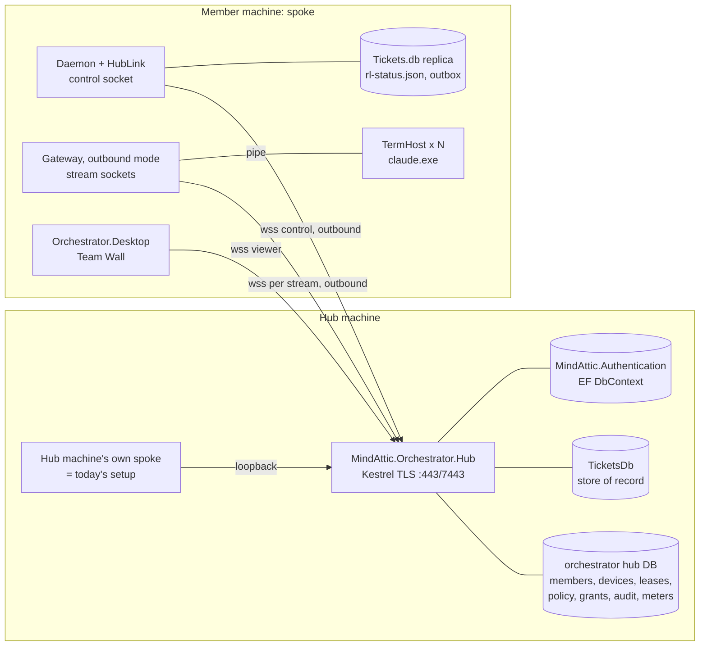
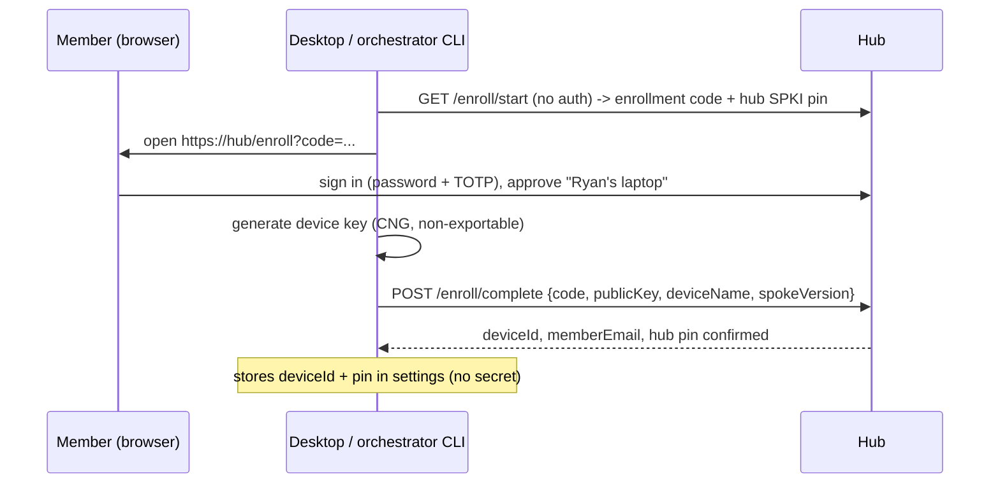
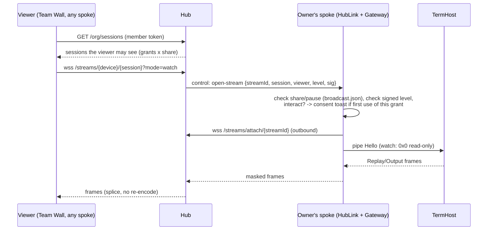

# Plan: the hub ("wheel") and its spokes (M.ORCH-T1127)

The research is in `1-research-spike.md`, and the phases are in `3-implementation-plan.md`. This document is the target
architecture.

## 1. The shape in one paragraph

- **One hub.** `MindAttic.Orchestrator.Hub` is an ASP.NET Core service on an always-on machine, reachable over a
  tailnet or a public TLS name. It is the org's single source of truth for:
  - who is in the org;
  - which devices belong to whom;
  - the ticket queue and who holds which ticket;
  - the org's pacing policy;
  - who may watch or type into what.
- **Many spokes.** A spoke is a member's machine running today's Orchestrator: the daemon, TermHost, the dashboard, the
  Launcher and the hooks. It adds one **outbound** link to the hub.
- **CLIs, Claude logins, credentials and masking stay on the spoke.**
- **The hub relays and decides. The spoke executes and enforces.**
- Today's setup is a hub that is switched off. Later it can be a hub and a spoke on the same machine.

## 2. Roles: what runs where

| Concern | Hub | Spoke |
|---|---|---|
| Member sign-in (MindAttic.Authentication: password, TOTP) | **Owns** | Opens the browser to the hub |
| Device enrollment and keys | Records each public key, revokes, issues 15-minute access tokens | Generates and holds a non-exportable key (CNG; TPM when present) |
| Members, orgs, `org_members`, roles | **Store of record** | Read-only cache pushed by the hub (`StateBus` kinds) |
| Tickets (`TicketsDb` on the hub's SQL Server or SQLite) | **Store of record** and the Tickets API | Local `Tickets.db` **replica** for the hooks and Tickets Desktop; writes go through the hub |
| Claims | **Leases** with renewal and fencing | Holds its leases, renews them on heartbeat, and works the ticket locally |
| Claude logins, `.credentials.json`, `setup-token` tokens | Never sees them | **Owns** them (DPAPI, local Vault) |
| CLIs (TermHost, ConPTY, claude.exe) | None for members. The hub machine may also run a spoke | **Runs them all** |
| Meter readings (`MeterReading`) | Merges them per login, keeps the history (`usage_samples`, `pace_ledger`), shows the org view | Reads Claude's meter (statusline, `ClaudeMeterProbe`) and pushes what it read |
| Pacing policy (`PaceTargetPercent`, `org limit`, `org allow`, routing) | **Decides** and pushes it | Caches it. `AccountPacer` and the hooks **enforce** it locally and offline |
| Subagent allowance for a login used on two spokes | Splits it (the `SubagentShare` rule across devices) | Enforces its share |
| Vault API key | Never holds it | Only on **key-holder** spokes (designated by an admin) |
| Terminal stream relay | Splices a viewer socket to a spoke socket; enforces grants; audits | Dials out per stream; **masks**, applies share, pause and consent |
| Grants (`term_grants`) and audit (`term_audit`) | **Store of record** | Re-checks the hub's signed decision; buffers audit records in the outbox |
| Git sync of `data/*.db` | Only the hub machine commits | Off while joined |
| Dashboard (Orchestrator.Desktop) | Serves its data over the API | Runs it. In join mode it shows the whole org, with remote people read-only unless granted |

## 3. Components



New pieces:

- **`MindAttic.Orchestrator.Hub`.** A new project. It references `Hub.Contracts`, `Term` and `MindAttic.Tickets`, and it
  hosts MindAttic.Authentication.
- **`MindAttic.Orchestrator.Hub.Contracts`.** A new library with no dependencies, like `Term`. It holds the envelope
  records, the lease and policy types, and the protocol version. The hub, the daemon, the gateway and the CLI all
  reference it.
- **`HubLink`** in Core. The daemon's client: one control socket, an outbox and a heartbeat. Behind it sit the seams
  of §6.
- **Gateway outbound mode.** The same `TermBridge` and `StreamMasker`, but the WebSocket is dialled *to* the hub
  instead of accepted. The inbound peer mode stays as it is.

## 4. Data and control flows

### 4.1 Enrollment, once per device



### 4.2 Connect and heartbeat

- The spoke sends a challenge signed with its device key to `POST /device/token` and gets a 15-minute access token.
- It opens `wss://hub/spoke` and sends:
  `hello {protocol, capabilities[], deviceId, spokeVersion, lastAckedSeq, leases[]}`.
- The hub answers: `welcome {protocol, policy, members, orgs, honouredLeases[], replicaCursor}`.
- Every 15 s, the daemon tick's own cadence, the spoke sends:
  `heartbeat {sessions[], clis[], meters[], leaseRenewals[]}`.
- The hub answers with deltas: policy, grants and the ticket replica.

### 4.3 Claiming a ticket

```mermaid
sequenceDiagram
  participant C as CLI (/allocate) on spoke
  participant L as HubLink (spoke)
  participant H as Hub
  C->>L: orchestrator next --claim (repos, login, room)
  L->>H: claim {device, login, repos, count, room}
  H->>H: Allocate rules: org routing, pins, priority, fair share;<br/>one transaction: lease rows + ticket_work
  H-->>L: leases [{ticket, leaseId, epoch, expiresUtc}]
  L->>L: worktree + Dispatcher (local, as today)
  loop each heartbeat
    L->>H: renew [leaseId, epoch]
  end
  C->>L: ticket closed (commit pushed)
  L->>H: complete {leaseId, epoch, commit}
  H-->>L: ok (or stale-epoch: lease was reassigned)
```

**Lease rules:**

- A lease lives 3 heartbeat intervals past its last renewal.
- An expired lease is held through an **offline grace** (a setting, 2 h by default) before the ticket is queued
  again.
- A renewal or a completion with an old epoch is refused, and the spoke is told so plainly.

### 4.4 Watching or interacting



### 4.5 Pacing

- **The spoke** reads Claude's meter as it does today and pushes `MeterReading`s.
- **The hub** merges them per login, keeping the freshest reading, or the highest within a window, as the statusline
  file does. It then pushes `policy {cutoffs, allowances, paceTarget, allowanceShare[login→device]}`.
- **`AccountPacer` on the spoke** computes `rl-status.json` from its local meter and the policy, and its hooks enforce
  it.
- **With no hub:** the last policy, or the defaults.

## 5. The trust model

- **The hub is trusted for decisions, not for execution.**
  - It can refuse, assign or revoke.
  - It can't read a credential, read an unmasked secret, unpause a paused session, share an unshared one, or type into
    a CLI whose owner hasn't consented on their own machine.
- **A spoke is trusted for its own member's logins only.**
  - Its reports about a login that isn't mapped to its member are dropped and audited.
  - Its claims are limited to its member's org (`OrgRouting`).
- **The owner's local switches always win** over anything from the hub: share, pause, mask, consent and kill. This
  matches "a person's own Claude use always wins".
- **Members' tokens:**
  - members get short-lived hub tokens from their sign-in;
  - devices get short-lived tokens from their key;
  - the existing owner-minted gateway tokens keep working for peer-to-peer mode.
- **The audit lives at the hub:** every attach, refusal, consent, input batch, claim, lease loss, enrollment and
  revocation.

## 6. Single-machine mode is "hub and spoke on one machine"

New setting `OrchestratorSettings.Hub.Mode`:

| Mode | What runs | Behaviour |
|---|---|---|
| `Off` (**default**) | Exactly today's processes | Every seam (`IClaims`, `IPolicySource`, `IMeterSink`, `IOrgDirectory`, `ISessionDirectory`) is its **Local** implementation, a pass-through to today's `Allocate`, `DispatchLease`, `TicketsDb`, `AccountPacer` and `TermSessions`. No socket and no new process |
| `Host` | Today's processes, the hub service on this machine, and this machine's spoke over loopback | This machine is the hub and also a spoke. Remote spokes may join. Local behaviour is unchanged, apart from claims becoming leases (still local) |
| `Join` | Today's processes plus a `HubLink` to a remote hub | Claims, policy and the org view come from the hub. The DB git sync is off. Local enforcement is unchanged |

The rule: **in `Off`, the diff is dead code.** A Local seam must behave the same as today's code, so the existing test
suite runs unchanged against it.

## 7. Non-goals

- Running members' CLIs on the hub, or on anyone's machine other than their own.
- Moving or copying Claude credentials, `setup-token` tokens or the Vault key off a machine that holds them.
- End-to-end encryption that hides masked terminal bytes from the hub. The hub is org infrastructure. This can be
  revisited later.
- A browser or mobile viewer. `/remote-control` already covers phones.
- Multi-hub, federation between orgs, or high-availability clustering of the hub. One hub, backed up.
- Replacing git as the code integration point, or syncing working trees between machines.
- Throttling or protecting machines from load. Per the owner's rules, only the hard cutoffs stop work.
- Changing how `/allocate` is turned on. The hub never turns `/allocate` on in a CLI. Remote dispatch to a member's
  machine needs that member's own opt-in setting on their spoke.
- Non-Windows spokes. TermHost is ConPTY-only today.
