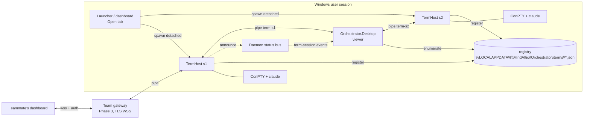

# Spike: CLIs that live outside the dashboard (M.ORCH-T922)

**Question.** Can each CLI live in memory outside Orchestrator.Desktop, so that the dashboard only shows an exact copy of it
and sends keys back? The goal is that the dashboard can crash, restart or redeploy without killing any CLI. Later, the
same copy could be shown to teammates as a "pixel perfect screenshare" of each person's real CLI.

**Short answer.** Yes. Every piece we need is either already in our dependencies or is a well-worn pattern (tmux, VS
Code's pty host). The renderer we use today, `Microsoft.Terminal.Wpf.TerminalControl`, takes any `ITerminalConnection`.
It does not care whether the bytes come from a local ConPTY or from a pipe to another process. I compiled a relay
connection against the exact package versions we ship (see section 2).

---

## Recommendation (read this first)

1. **Use the dtach model, not a tmux-style server.** Build one small, stable host executable, `MindAttic.Orchestrator.TermHost`,
   and run **one host process per CLI**. Each host owns exactly one ConPTY and one CLI, keeps a replay buffer, and serves
   one per-user named pipe. A crash in one host kills one CLI, never all of them. An upgrade never touches running
   sessions: old sessions keep the binary they started with, and new sessions start on the new one. This removes the
   "upgrade the host without killing sessions" problem rather than solving it.
2. **The dashboard becomes a viewer.** Each tab is a bare `TerminalControl` driven by a `RelayConnection : ITerminalConnection`
   that talks to that session's pipe. EasyWindowsTerminalControl drops out of the viewer, because it always spawns a local
   process. The keyboard, focus, copy and paste work (T852, T846, T824, T866, T867, T868) all lives on the viewer side and
   carries over almost unchanged. Only paste's write target changes.
3. **Phase 1 is the smallest change that ends "a dashboard crash kills every CLI".** It needs TermHost, a session registry,
   the relay viewer, and a late-attach replay built from a raw output ring plus tracked terminal modes. Estimate about
   2 weeks of focused work. After it lands, a dashboard crash or redeploy costs a 1 to 2 second reattach, not a
   `claude --resume`.
4. **Exact snapshots come in Phase 2**, from a headless VT emulator in the host (libghostty-vt first, vtnetcore as the
   managed fallback). Phase 2 also adds several viewers per session with a clear owner of the session's size.
5. **Team viewing comes in Phase 3**, through a TLS WebSocket gateway behind MindAttic.Authentication. Access is read-only
   by default, with per-member grants from `orchestrator.db` and an audit log. Anything on a CLI's screen is broadcast to
   its watchers, secrets included, and section 5 deals with that.
6. **Claude's own `/remote-control` and `stream-json` are useful companions, not a substitute.** They show a structured
   conversation, not the TUI, and they only work for Claude. Keep them for phone and low-bandwidth use (section 6).

```
 TODAY                                         PROPOSED
 ┌──────────── Orchestrator.Desktop ───────┐   ┌──────── Orchestrator.Desktop (viewer) ──────┐
 │ TerminalControl ── TermPTY ── ConPTY ─┐ │   │ TerminalControl ── RelayConnection ─┐       │
 │ TerminalControl ── TermPTY ── ConPTY ─┤ │   │ TerminalControl ── RelayConnection ─┤       │
 │ ... x12                               │ │   └─────────────────────────────────────│───────┘
 └───────────────────────────────────────│─┘        named pipes (per user, per session)
   dashboard dies => pipes close =>      │     ┌──────────────┐ ┌──────────────┐ ┌──────────────┐
   conhost exits => every claude dies    │     │ TermHost #1  │ │ TermHost #2  │ │ TermHost #12 │
                                         ▼     │ ConPTY+ring  │ │ ConPTY+ring  │ │ ConPTY+ring  │
                                   claude.exe  │  claude.exe  │ │  claude.exe  │ │  claude.exe  │
                                               └──────────────┘ └──────────────┘ └──────────────┘
                                                 dashboard dies => hosts keep running; reattach
```

---

## 0. Today, from the code

- `src/MindAttic.Orchestrator.Wpf/ViewModels/TerminalsViewModel.cs`: each `TerminalPaneViewModel` builds an `EasyTerminalControl`
  with `StartupCommandLine = request.ProcessCommandLine(pipeName)`. That control creates a `TermPTY`, which calls
  `CreatePseudoConsole` and starts PowerShell, then `MindAttic.Launcher host …`, then `claude`, all inside the dashboard
  process. Every ConPTY's pipe handles belong to the dashboard. When the dashboard dies, the pipes break. Conhost then sends
  its clients a close event and the whole tree exits. That is the 2026-10-25 failure: two crashes, every CLI lost.
- `src/MindAttic.Orchestrator.Core/Sessions/TerminalPanes.cs`: `PaneBroker` is the dashboard's per-user pipe
  (`mindattic-orchestrator-terminals-<user>`, `PipeOptions.CurrentUserOnly`). The Launcher (M.LNCH-T77) sends a
  `PaneRequest` down it as one line of JSON. When nobody is listening, the Launcher falls back to a Windows Terminal window.
- `MindAttic.Launcher host` (`Commands/HostAgentCommand.cs`) does **not** own a PTY. It resolves the project, sets the title
  and runs the agent with inherited stdio. Today the dashboard is the only PTY owner.
- `src/MindAttic.Orchestrator.Wpf/SessionRestore.cs` (T862) writes every tab's Claude session continuously. After an unclean
  exit, the next start offers `claude --resume`. That recovers the conversation, but not the process: in-flight tool calls,
  the running bash, the scroll position and the half-typed prompt are all lost.
- `deploy.ps1` (T873) refuses to install while any hosted CLI is busy, because an install restarts the dashboard.
- `Daemon.cs` is the always-on logon job (status bus T854/T872, app bus T879/T891). It changes often, so it is a poor
  home for something that must never restart (section 7).

## 1. Architecture: who owns the PTY

### Prior art

| System | Who owns the PTY | What a late viewer gets | Size with several viewers | Transport and auth | Runs on Windows natively | What to borrow |
|---|---|---|---|---|---|---|
| **tmux** | One server per user owns every pane's pty and keeps its own emulator grid per pane | Server re-renders the grid for each client's terminal | `window-size` option: `largest`, `smallest`, `manual`, `latest` (follows the most recently active client) | Unix socket, filesystem permissions | No (WSL/Cygwin only) | Emulator per pane; a server-side redraw; a size policy chosen per window |
| **GNU screen** | One server process per session | Redraws from its own screen copy | Smallest attached display wins | Unix socket; multiuser ACLs (`acladd`, `aclchg`) for read-only users | No | Per-user ACLs, including read-only watchers |
| **dtach / abduco** | **One tiny process per session**; no emulator | dtach: nothing (a redraw trick such as Ctrl+L or SIGWINCH); abduco: same | One owner | Unix socket | No | **The process model**: one session per process, so a crash or upgrade is isolated |
| **WezTerm mux** (`wezterm-mux-server`) | Mux server owns panes; GUI is a client | Server holds the terminal model and sends lines and changes, not raw bytes | Per-client | "Unix domains" (also on Windows), SSH domains, TLS domains with bootstrap over SSH | **Yes**, including Unix domains on Windows | Proof that a mux server with a separate GUI client works on Windows; the TLS domain bootstrap idea |
| **Zellij** | Server per session; clients attach | Server-side state, re-rendered | Per-client | Unix socket; recent versions add a web client with login tokens | Not natively | A web client with token login for remote viewers |
| **Windows Terminal** | Each window process owns its ConPTYs | Persisted layout restores the *text* of buffers on restart, not the processes | n/a | n/a | Yes | Nothing for detach (it has none); `ITerminalHandoff` shows a conhost session *can* move between processes (section 7) |
| **tmate** | tmux fork; a relay server mirrors the session | Relay replays the tmux state | tmux rules | SSH to the tmate relay; separate read-only and read-write URLs | No | **Separate read-only and interactive join links** |
| **upterm** | Host CLI owns the pty; uptermd relays over reverse SSH | Live stream only | Host's size | SSH; `--authorized-keys`, `--github-user`; `--read-only` | Partial | **Identity-pinned joiners and a read-only flag** |
| **tty-share** | Host owns the pty; a proxy relays over WebSocket; xterm.js in the browser | Live stream | Host's size | HTTPS/WebSocket; read-only flag | Partial | Browser viewer over a WebSocket |
| **VS Code pty host** | A separate `ptyHost` process owns every pty; windows are clients | A per-terminal `@xterm/headless` instance records all output. On reconnect, `@xterm/addon-serialize` produces a replay event (cols, rows and serialized VT data) | Last attached window | Local IPC; a heartbeat restarts a hung host | Yes | **Headless emulator plus serialize-on-attach**; orphan detection with grace timers; buffered output; flush before a resize |

**What VS Code does, from its source** (`src/vs/platform/terminal/node/ptyService.ts`):

- `PtyService` keeps a `PersistentTerminalProcess` per id.
- Each one owns an `XtermSerializer`, which feeds every data event into an `@xterm/headless` `Terminal` with the session's
  cols, rows and a scrollback limit taken from `reconnectConstants`.
- `generateReplayEvent()` loads `@xterm/addon-serialize` and emits `{cols, rows, data}`. It can exclude the alternate
  buffer and modes (`normalBufferOnly`).
- On disconnect, `detach()` arms a grace timer (`graceTime`, cut down to `shortGraceTime` by `reduceConnectionGraceTime`),
  after which an unclaimed pty is shut down.
- Orphan detection asks the windows "is this yours?" (`_onProcessOrphanQuestion`). It waits on an `AutoOpenBarrier(4000)`
  and treats no reply within 500 ms of the check as orphaned.
- Output goes through a `TerminalDataBufferer`, and `resize()` flushes it first.

Phase 2 copies this design almost exactly, with one change. VS Code runs **one** pty host for all terminals and pays for
it with a heartbeat-and-restart system. Per-session hosts make that unnecessary.

### The shape for MindAttic



**Host candidates, compared:**

| Option | Verdict |
|---|---|
| The dashboard (today) | Rejected: it is the process that crashes and gets redeployed |
| The daemon | Rejected as the PTY owner: it is redeployed with every Orchestrator change, and a hang in it would freeze every CLI. It stays the **registry and announcer** on the status bus |
| The Launcher | Close, because `Launcher host` already runs once per tab. But the Launcher is a Spectre CLI with a menu and its own release cadence, and it runs inside the PTY rather than owning it. It stays the **requester** |
| One shared TermHost server (tmux style) | Workable, but needs ConPTY handle handoff to upgrade without losses, and one bug kills all sessions |
| **One TermHost per session (dtach style)** | **Chosen.** About 10 to 15 MB extra per session as NativeAOT (section 7). Isolation and upgrade-by-attrition come free |
| A Windows service | Rejected: it would run in session 0. Spawning claude into the user's desktop needs `CreateProcessAsUser` and token juggling, and `claude /login` opens a browser, which needs the interactive session. Use a per-user process started like the daemon instead |

**Lifetime rules for TermHost:**

- It is started *detached*: `CREATE_NEW_PROCESS_GROUP | DETACHED_PROCESS | CREATE_BREAKAWAY_FROM_JOB`, falling back to a
  plain detached start when the parent's job forbids breakaway. Its parent is never the dashboard's job, so a dashboard
  crash, or a debugger or Windows Terminal job closing, cannot take it down.
- It exits when its CLI exits, after a grace period so a viewer can read the last lines. The default is 10 minutes after
  exit if no viewer is attached, and immediately once a viewer closes the tab.
- An idle session with no viewer stays alive indefinitely. That is the whole point. Orphan handling is in section 7.

## 2. The viewer in .NET and WPF: can `TerminalControl` be driven remotely? **Yes.**

From the decompiled `CI.Microsoft.Terminal.Wpf 1.25.260303002` and `EasyWindowsTerminalControl 1.0.38` (made with ilspycmd
into the spike's scratch directory):

```csharp
public interface ITerminalConnection {           // Microsoft.Terminal.Wpf
    event EventHandler<TerminalOutputEventArgs> TerminalOutput;  // backend -> renderer (VT text)
    void Start();                                 // called when the connection is set
    void WriteInput(string data);                 // renderer -> backend (keys, already VT-encoded)
    void Resize(uint rows, uint columns);         // renderer computed a new grid
    void Close();
}
public partial class TerminalControl : UserControl {
    public ITerminalConnection Connection { set; } // any implementation
    public bool AutoResize { get; set; }
    public Task ResizeAsync(uint rows, uint columns, CancellationToken ct); // fixed grid (non-owner viewers)
    public string GetSelectedText();
    public void SetTheme(TerminalTheme theme, string fontFamily, short fontSize, Color externalBackground = default);
    public int Rows { get; } public int Columns { get; }
}
```

`TerminalContainer` (the `HwndHost`) shows the whole contract:

- **Output:** `connection.TerminalOutput += …` leads to `NativeMethods.TerminalSendOutput(terminal, e.Data)`. That is a
  plain string of VT and can arrive from any thread, which is what `TermPTY` does today.
- **Input:** the native control's write callback calls `OnWrite(data)` and then `Connection?.WriteInput(data)`. Keys arrive
  already encoded as VT. Because EasyWindowsTerminalControl sends `ESC[?9001h` to the renderer, they are **win32-input-mode**
  sequences (`ESC[Vk;Sc;Uc;Kd;Cs;Rc_`), which ConPTY decodes back into full key events. The relay passes them through
  unchanged.
- **Resize:** the renderer calls `Connection?.Resize(rows, cols)` whenever its grid changes (`AutoResize`), or on
  `ResizeAsync`.
- **Setting `Connection`** first writes `ESC c ESC]104 ESC\` (a full reset) to the renderer, then calls `Start()`. **A
  reattach therefore always starts from a blank screen.** The connection must replay the snapshot *after* `Start()`, then
  stream live output.

`EasyTerminalControl` is a thin wrapper: theme, `InputCapture` keyboard navigation, a `Terminal` property, and `TermPTY`.
`TermPTY` is itself just an `ITerminalConnection` over ConPTY. But `EasyTerminalControl.TermInit` starts a local process
from `StartupCommandLine` on `Loaded`, and `TermPTY.Start(...)` is not virtual. So the viewer should host a **bare
`TerminalControl`** inside our own small `RelayTerminal` control. It copies the about 40 lines we use from
EasyTerminalControl: the theme with the font, `KeyboardNavigation` contained for Tab and arrows, focus forwarding, and
sending `ESC[?9001h` to the renderer after each (re)connect.

**Compile check.** The scratch project `relayprobe` (net10.0-windows, EasyWindowsTerminalControl 1.0.38) builds cleanly
with:

```csharp
public sealed class RelayConnection(Stream stream) : ITerminalConnection
{
    public event EventHandler<TerminalOutputEventArgs>? TerminalOutput;
    public void Start() => Task.Run(async () => { /* read frames; TerminalOutput?.Invoke(this, new(text)) */ });
    public void WriteInput(string data) { /* send an Input frame */ }
    public void Resize(uint rows, uint columns) { /* send a Resize frame (owner only) */ }
    public void Close() => stream.Dispose();
}
// Bare:    new TerminalControl { Connection = new RelayConnection(pipe) };
// Swapped: easy.DisconnectConPTYTerm(); easy.Terminal.Connection = new RelayConnection(pipe);
```

The "swapped" form works too, but it races `EasyTerminalControl`'s own start-on-load, so the bare control is cleaner.
Behaviour at run time (resize, win32-input-mode, replay after the reset) is the first follow-up ticket. That prototype was
not run here because it needs a visible window, and the spike must not disturb the running dashboard.

## 3. State on attach: screen, scrollback and modes

A viewer that attaches late, or reattaches after a crash, needs four things:

- the visible screen,
- the scrollback,
- the terminal modes the CLI turned on,
- the cursor.

### Option A: a raw replay ring (Phase 1)

The host keeps the raw UTF-8 VT output in a bounded ring (4 MB per session by default). It **resets the ring's start** at
every full clear the CLI emits (`ESC c`, or `ESC[2J` together with `ESC[3J`). It also tracks a small set of **sticky
modes** by scanning output, the way `TerminalPaste.Scan` already watches bracketed paste:

| Mode | Sequence |
|---|---|
| Bracketed paste | `?2004` |
| Cursor visibility | `?25` |
| Alternate screen | `?1049`, `?47`, `?1047` |
| Application cursor keys | `?1` |
| Mouse tracking | `?1000`, `?1002`, `?1003`, `?1006` |
| Focus events | `?1004` |
| Synchronized output | `?2026` |
| Window title | OSC 0/2 |

On attach, the host sends this to the viewer:

1. the replay frame: ring contents, then the current modes re-asserted, then a cursor-position report;
2. a "live" marker;
3. the live stream.

The host serializes "copy ring" and "subscribe" under one lock, so no byte is lost or doubled between them.

- **Pros:** about 300 lines; no third-party emulator; exact for Claude Code's normal, inline rendering as long as the
  viewer's grid equals the session's (the host enforces that, see "Resize").
- **Cons:** if the session was resized in the past, replaying older bytes at the current size can garble earlier
  scrollback. Ink-style TUIs rewrite their live region with cursor-up and erase, so replay costs CPU proportional to the
  bytes, not to the screen. In practice the WT renderer handles a few MB in well under a second. After the ring wraps,
  the oldest scrollback is gone.
- **Cheap fix-up:** after the replay, the host nudges the ConPTY with resize (cols-1), then resize (cols). Claude Code
  and other TUIs redraw their live region on resize, so whatever the replay got wrong in the visible area is repainted
  correctly. (dtach users rely on the same trick: Ctrl+L or SIGWINCH.)

### Option B: a headless VT emulator in the host (Phase 2)

This is what VS Code and tmux do. The host feeds every output chunk to an in-memory emulator. On attach it **serializes
the emulator's state** into a compact VT stream, `{cols, rows, data}`, that recreates scrollback, screen, attributes,
cursor and modes exactly at the current size. Candidates:

| Engine | Language | Fit |
|---|---|---|
| **libghostty-vt** | Zig, with a C API; no libc dependency; builds for Windows | Best fidelity, proven by Ghostty. Its C API signatures are still in flux, so pin a version and P/Invoke it from TermHost. **First choice** |
| libvterm | C | Mature (Neovim uses it). Needs our own serializer, has no reflow, and its scrollback is callback-based |
| vtnetcore (VtNetCore.XTermParser) | C# | Managed, so no native build, but old and lightly maintained. **Fallback** |
| @xterm/headless + addon-serialize | JS | Exactly VS Code's path, but drags Node into every host. Rejected |
| Windows Terminal's own buffer | — | `Microsoft.Terminal.Wpf` exposes no buffer read (only `GetSelectedText`), and conhost's console API (`ReadConsoleOutputW` after `AttachConsole`) returns legacy 16-color attributes, which loses 24-bit color. Rejected for snapshots |

### Alternate-screen TUIs

Claude Code normally renders **inline in the main buffer**: its transcript scrolls into scrollback and its live region is
redrawn in place. Full-screen programs it may run (`less`, `vim`, a fullscreen rendering mode where one is enabled) switch
to the alternate screen with `?1049h`.

- **Option A** handles this correctly as long as the ring still holds the `?1049h` and everything after it. Mode tracking
  guarantees the viewer ends up on the right buffer.
- **Option B** serializes both buffers and the active one. Like VS Code's `normalBufferOnly`, a viewer can choose to see
  just the normal buffer.

### Resize ownership with several viewers

ConPTY has one size, so one party must own it.

| Policy | Behaviour | Verdict |
|---|---|---|
| tmux `smallest` | Every viewer gets the smallest grid | Penalizes the main user whenever a teammate watches from a laptop |
| tmux `latest` | The most recently active client sets the size | Good locally |
| **Per-session owner** | The **interactive viewer that last sent input or took focus** owns the size; its `Resize` frames are applied. Every other viewer runs `TerminalControl.AutoResize = false` with `ResizeAsync(session rows, cols)` and letterboxes. Read-only remote watchers can never change the size. A viewer can explicitly "Take size" | **Chosen** |

The host broadcasts a `size` frame on every change, so viewers that don't own the size follow it. Like VS Code, the host
flushes buffered output before applying a resize.

## 4. Input, focus and clipboard

All of these stay **in the viewer**, because they are about how WPF routes keys around a native child window:

| Work | Today | After |
|---|---|---|
| T852 navigation keys posted to the terminal's HWND | `TerminalKeyboard` | Unchanged: the same `HwndHost` |
| T846 binding gate and focus return | `TerminalKeyboard.GateBindings`, `MainWindow` | Unchanged; `HoldsFocus` looks for `RelayTerminal` instead of `EasyTerminalControl` |
| T824 Ctrl+Left/Right tab switching | `PersonTerminalsViewModel` | Unchanged |
| T867/T866 copy and cut with a selection | `TerminalControl.GetSelectedText()` | Unchanged: the selection is local to the renderer |
| T868 paste | `term.WriteToTerm(payload)` on the local `TermPTY`; bracketed mode from `InterceptOutputToUITerminal` | `connection.WriteInput(payload)`. The bracketed flag comes from the host's tracked modes (sent on attach and on change), not from scanning output in the viewer, so a reattached viewer knows the mode at once |

**Key relay.** The renderer produces win32-input-mode VT (since `?9001h`), and the viewer sends it as an `Input` frame. The
host writes it unchanged to the ConPTY input pipe, which decodes it into `KEY_EVENT_RECORD`s for claude. Ctrl+C reaches
claude as a key event, exactly as today. Nothing is re-encoded, so behaviour is identical.

**Paste.** The viewer builds the payload with `TerminalPaste.Payload(text, bracketed)`: CRLF and LF become CR, and the text
is wrapped in `ESC[200~` and `ESC[201~` when bracketed. It sends one `Input` frame. Large pastes are chunked at 64 KB per
frame, and the host writes the frames in order. With several interactive viewers, input is *merged* (tmux semantics). The
UI shows a "someone else is typing" hint when two viewers sent input within 2 seconds.

**Focus events (`?1004`).** Send `ESC[I` and `ESC[O` from the size-owning viewer only. Otherwise every watcher's focus
change reaches the CLI.

## 5. Transport and security

### Locally: a separate pipe per session, not the status bus

The status bus (`docs/app-bus.md`, `Core/Status/AppBus.cs`) is NDJSON fan-out through the daemon. It is the right place to
**announce** sessions: a new `term-session` kind (v1) with `{id, pid, pipe, title, login, repo, cols, rows, state}`,
published when a host starts, ends or changes title. It is the wrong place for **terminal bytes**:

- it hops through the daemon;
- it JSON-escapes every byte;
- heartbeat and backpressure rules shared with tickets would let one chatty CLI delay everything;
- the daemon restarts on every deploy.

So each host serves **its own pipe**, `mindattic-term-<user>-<sessionId>`, with `PipeOptions.CurrentUserOnly` like
`PaneBroker`, using a small binary framing:

```
frame := u8 kind | u32 length | payload
kinds:  Hello{protocol, viewerId, interactive, cols, rows}   viewer -> host
        Replay{cols, rows, modes, data}  Live  Output{data}  Size{cols, rows}  Modes{...}
        Title{text}  Exit{code}          host -> viewer
        Input{data}  Resize{cols, rows}  TakeSize  Ping       viewer -> host
```

The registry is one JSON file per live host, so a viewer can find sessions even when the daemon is down. The status-bus
announcement is the fast path; the files are the truth.

### Bandwidth and latency for a dozen live TUIs (estimates)

| Activity | Rate per session | x12 |
|---|---|---|
| Claude idle at the prompt | ~0 | ~0 |
| Working (spinner, token counter, about 10 redraws per second of a 1 to 3 line region) | 1 to 3 KB/s | 12 to 36 KB/s |
| Streaming a long answer or tool output | 5 to 30 KB/s | up to ~360 KB/s if all burst at once |
| Full repaint (resize or attach, 120x40 with 24-bit color) | 15 to 40 KB once | — |
| Attach replay (Option A ring) | up to 4 MB once; typically <500 KB | — |

- **Locally:** pipe latency is under 1 ms, so keystroke echo looks the same as today.
- **On a LAN with TLS:** add 1 to 5 ms.
- **Over the internet:** add the round trip time (RTT). Interactive typing is fine up to about 100 ms; past that, prefer
  read-only.
- Compress remote streams with `permessage-deflate` on the WebSocket. VT compresses 5 to 10x.

### Team viewing across machines (Phase 3)

```
Ryan's PC                                             Teammate's PC
TermHost x N ─pipe─ Gateway (ASP.NET Core, Kestrel) ─wss/TLS─ Dashboard viewer (RelayConnection over WebSocket)
                     │  MindAttic.Authentication (login, TOTP)
                     │  ACL from orchestrator.db (members, org_members)
                     └  audit log
```

- **Placement.** The gateway is a per-machine service that bridges local pipes. A central relay (as tmate and upterm use)
  would only be needed across NAT; Tailscale or a VPN avoids that for a small team.
- **TLS** with a certificate the team trusts. Alternatively, copy WezTerm's TLS domain idea and bootstrap a pinned
  certificate over an already-authenticated channel.
- **Authentication.** MindAttic.Authentication is an ASP.NET Core Razor Class Library (Argon2id, TOTP, lockout, audit), so
  the gateway can host it directly. A viewer signs in once and holds a short-lived token for its WebSocket connections.
- **Authorization.** `orchestrator.db` has `members(email, role, …)` and `org_members(provider, login, org_id, person)`.
  Add a `term_grants(owner, viewer, level, expires_utc)` table, where `level` is `watch` or `interact`.
  - Default: members of the same org may **watch**. **Interact** must be granted explicitly, per person or per session,
    with an expiry.
  - The owner sees a "being watched by …" banner, as screen's `acladd`, tmate's separate read-only and read-write links,
    and upterm's `--read-only` with `--github-user` all do.
- **Secrets on screen are broadcast.** API keys echoed by a command, `.env` files Claude reads, and tokens in tool output
  all go out byte for byte. A "pixel perfect" copy cannot be selectively blind. Mitigations:
  1. Remote watching is opt-in per session, not global.
  2. Remote streams go through an optional **masker**. It replaces runs matching known token shapes (`sk-ant-…`,
     `ghp_…`, AWS key ids, JWTs, Vault-sourced values) with `•••` **before** the bytes leave the machine. That breaks
     exactness only where a secret was.
  3. A one-keystroke "pause broadcast" on the owner's side.
  4. The audit log records who attached when, and every remote `Input` frame.

  The masker never applies to the local viewer.

## 6. Claude-specific alternatives

| Approach | What it gives | Against "pixel perfect" |
|---|---|---|
| **`/remote-control`** (`claude remote-control`, alias `/rc`) | A local session driven from claude.ai/code or the mobile app; execution stays local; push notifications. We already rely on it (it replaced MindAttic.Mobile) | Structured conversation, not the TUI; Claude only; needs Anthropic's relay; off by default on Team plans until an admin enables it; one session at a time per link. **Complements** the host: run it inside a hosted CLI for phone access |
| **`claude --resume`** after a host restart (T862) | Conversation continuity | Loses the process, its children and in-flight work. Stays as the **fallback** for a host that dies, as today |
| **Headless** `claude -p --output-format stream-json --input-format stream-json`, or the Agent SDK | Machine-readable events (messages, tool calls, results); trivial to broadcast and to render as cards; tiny bandwidth; easy to redact | Not the real CLI. No slash-command UI, permission prompts look different, and our hooks and statusline behave differently. Codex and other providers need their own adapters. Only useful for a **summary view** ("what is everyone doing") beside the real terminal |

**Verdict.** Mirror the real TUI, which is what the user asked for and works for every provider. Optionally add a
structured activity feed later for the team wall and for phones. The daemon already sees each CLI's state through its
hooks, which is a cheap source for that feed.

## 7. Failure modes

| Failure | Today | After |
|---|---|---|
| Dashboard crash or redeploy | Every CLI dies | No CLI dies; the dashboard reattaches from the registry on start (about 1 to 2 s) |
| One TermHost crashes | n/a | **One** CLI dies (its ConPTY closes); T862's `--resume` offer covers that tab only. TermHost is small (pipe server, ring, ConPTY), so the crash surface is far smaller than WPF's |
| TermHost upgrade | n/a | Install side by side: `TermHost\<version>\`. New sessions use the newest, running ones keep theirs, and the folder of a version is deleted once no process runs from it. The protocol is versioned in `Hello`, and a viewer speaks every version still running |
| ConPTY handle handoff (stretch) | n/a | Possible in principle. A ConPTY is anonymous pipes plus a signal pipe, a reference handle and the conhost process; Windows Terminal's default-terminal `ITerminalHandoff` hands a live conhost session to another process, and node-pty is gaining an option to adopt `{input, output, signal, ref, server, client}`. But `HPCON`'s internals are undocumented. **Not needed** with per-session hosts; revisit only if one shared host is ever chosen |
| Orphaned sessions (no viewer, CLI waiting forever) | n/a | A session is never killed for lacking a viewer. The dashboard shows it, with a "Detached" badge per person. The daemon reports sessions idle for more than N hours (a setting) on the status bus. A host whose CLI exited lingers 10 minutes, then exits |
| Stale registry entries | n/a | Each entry holds the host's pid and start time; a viewer drops one whose process is gone or was reused |
| Memory per session | ConPTY and buffers inside the dashboard | conhost 5 to 10 MB; TermHost about 10 to 15 MB (NativeAOT) or 30 to 40 MB (JIT); ring 4 MB; Phase 2 emulator with 10k lines x 120 cols about 15 to 25 MB worst case. Claude itself (300+ MB) dominates either way. About 40 to 60 MB of overhead per session, or about 0.5 to 0.7 GB for a dozen |
| Logoff, reboot | Everything dies | Everything still dies: the hosts are per-user processes. Keep T862's restore file, now written by each host, so the next logon offers `--resume` for each. A Windows service in session 0 could survive logoff but not run claude in the user's desktop; rejected in section 1 |
| Sleep, hibernate, RDP reconnect, lock | Fine | Fine: no process changes |
| Dashboard running from a job object (debugger, CI) | n/a | Hosts are started with breakaway, or by a broker that isn't in the job (the daemon's `spawn-term` inbox kind), so they don't die with the dashboard's job |
| Two dashboards attached | Impossible | Supported: both stream; the size goes to its owner (section 3) |

**How is this better than today if a host can still crash?** It narrows the blast radius from 12 CLIs to 1, and it moves
the PTY out of the most complex, most often redeployed process (a WPF app with a dozen `HwndHost`s and timers) into the
simplest, most rarely changed one. It also ends the T873 tension: a dashboard deploy no longer needs every CLI to be idle.

## 8. Phased plan

| Phase | Goal | Effort | Ends |
|---|---|---|---|
| **0. Prove it** | A scratch WPF window with a bare `TerminalControl` and a `RelayConnection` to a stub host that owns a ConPTY running `claude`; kill and restart the viewer; check win32-input-mode, Ctrl+C, paste, resize, replay after the reset | 1 to 2 days | Unknowns about the renderer |
| **1. Survive the dashboard** | TermHost per session, registry, relay viewer, ring replay with mode tracking, deploy decoupling | ~2 weeks | **"A dashboard crash kills every CLI"** |
| **2. Fidelity and many viewers** | Headless emulator snapshot, size ownership, pop-out viewers, versioned host install | 2 to 3 weeks | Garbled late attach; one viewer per CLI |
| **3. Team screen-share** | TLS WebSocket gateway, auth, ACL, audit, masking, a team wall | 3 to 5 weeks | "Can't see what everyone is doing" |
| **4. Optional** | A structured activity feed for phones and the wall | 1 week | — |

**Follow-up tickets** (filed unapproved, each a follow-up of M.ORCH-T922):

Phase 0
- M.ORCH-T923: Prototype a relay viewer: a bare TerminalControl with a pipe-fed ITerminalConnection against a stub ConPTY host; verify keys, paste, resize and replay after a viewer restart.

Phase 1
- M.ORCH-T924: TermHost: a detached per-CLI process that owns one ConPTY and serves a per-user, per-session named pipe (framed output, input, resize, exit), outliving the dashboard.
- M.ORCH-T925: Session registry and discovery: hosts register under %LOCALAPPDATA% and announce a term-session kind on the status bus; the dashboard reattaches on start.
- M.ORCH-T926: Dashboard viewer: Terminals tabs use a RelayTerminal (bare TerminalControl and RelayConnection) instead of EasyTerminalControl; port T852, T846, T824 and T866 to T868.
- M.ORCH-T927: Late-attach replay: a raw output ring reset at full clears, with sticky-mode tracking and a redraw nudge, so a reattached viewer shows the current screen.
- M.ORCH-T928: Deploy and restore: installs never stop TermHosts, the T873 idle gate applies only to unhosted CLIs, and T862 restore covers only sessions whose host died.
- M.LNCH-T82: Launcher opens CLIs through a TermHost when no dashboard is listening, so they appear on the dashboard's next start instead of in a Windows Terminal window.

Phase 2
- M.ORCH-T929: Headless VT emulator in TermHost (libghostty-vt first, vtnetcore as fallback) for exact screen and scrollback snapshots on attach.
- M.ORCH-T930: Multi-viewer size policy: the interactive viewer that last sent input owns the size, others letterbox, and a viewer can take the size explicitly.
- M.ORCH-T931: Pop-out and second-instance viewers: open any hosted CLI in another window, read-only or interactive, alongside its tab.
- M.ORCH-T932: Versioned TermHost protocol and side-by-side installs: running sessions keep their host binary, and old versions are cleaned up once unused.

Phase 3
- M.ORCH-T933: Team gateway: an ASP.NET Core TLS WebSocket service that bridges local TermHost pipes to authenticated remote viewers.
- M.ORCH-T934: Viewing ACL and audit: watch and interact grants from members and org_members, read-only by default, every attach and remote input logged.
- M.ORCH-T935: Broadcast secret hygiene: an opt-in masker for token-shaped strings on remote streams, a "being watched" banner and pause broadcast.
- M.ORCH-T936: Team wall: a dashboard grid of every member's live CLIs through the gateway.

Phase 4
- M.ORCH-T937: Structured activity feed: evaluate stream-json, hooks and Remote Control as a low-bandwidth "what is everyone doing" view beside the real terminals.

## Phase 0 results (M.ORCH-T923, 2026-10-26)

`prototypes/T923-relay/`: a TermHostStub (one ConPTY per detached process, 4 MB ring, sticky modes, per-session pipe) and a RelayViewer (a bare `TerminalControl` driven by a `RelayConnection`). It was tested against a live `claude` session and a Windows PowerShell session. Keys were sent with a pipe client using the renderer's own win32-input-mode encoding, and every result was checked through the viewer's screen.

**Verdict: GO for Phase 1.** All seven checks pass.

| Check | Result |
|---|---|
| 1. Attach and render | Pass. The real Claude TUI shows pixel-identical in the viewer |
| 2. Keys (typing, Home/End/Left, Backspace, Enter, Ctrl+C) | Pass. `cho abcdef` + Home `e` + End `Z` Backspace + Left Left `X` + Enter printed `abcdXef`, and Ctrl+C broke a stuck prompt |
| 3. Paste | Pass. A two-line paste reached Claude bracketed (the host tracked `?2004`) and was not submitted |
| 4. Resize | Pass. Resizing the window took the host to 80x23, and Claude reflowed |
| 5. Reattach mid-work | Pass. Output kept going with no viewer attached; on reattach the missed lines replayed, then the stream continued live. A half-typed Claude prompt survived the viewer closing |
| 6. Viewer force-killed | Pass. Both hosts survived, and a new viewer process reattached to the exact screen |
| 7. CLI exit | Pass. The viewer shows the exit code, and the host lingers 60 s, then exits |

**Bugs found and fixed in the prototype (carry these into Phase 1):**

1. **Deadlock on connect.** Raising `TerminalOutput` from the pipe's reader thread while the renderer resizes on the UI thread froze the viewer. `RelayConnection` now captures the UI `SynchronizationContext` in `Start()` and posts output to it, in order. T926 must do the same.
2. **Stale host size.** The renderer reports its grid before the connection exists, so the host stayed at the Hello default and Claude drew for the wrong size. The viewer now sends the terminal's actual rows and cols right after setting `Connection`.
3. **Navigation keys.** WPF keyboard navigation swallows arrows, Home/End and PgUp/PgDn before the native renderer sees them (the T852 problem). Posting `WM_KEYDOWN` to the renderer's HWND lost and reordered keys. Sending them as win32-input-mode sequences through the connection is deterministic. T926 should use that rather than T852's PostMessage.
4. **Use the bundled ConPTY.** The host now imports `CreatePseudoConsole` and its siblings from `conpty.dll` (`Microsoft.Windows.Console.ConPTY` 1.24.260710001), the same one the app gets through EasyWindowsTerminalControl, instead of kernel32's inbox copy.

**Open items for Phase 1:**

- **Replay garbling.** A replay at a different size than the session's history (attach at 118x32 after 120x30 output) duplicates or clips some earlier lines. The visible TUI region repaints correctly after the redraw nudge. This is expected for Option A; Phase 2's emulator (T929) removes it.
- **Bad command crashes the host.** A command that isn't found (`pwsh` isn't installed on this machine, yet it's the host's default) crashed the host with an unlogged Win32Exception. T924: log and exit cleanly, and default to `powershell.exe` when `pwsh` is missing.
- **PSReadLine prompt overwrite.** When a prompt wraps exactly at the edge, PSReadLine's redraw overwrote the trailing `>`. It's cosmetic and the same in a plain terminal.
- **One viewer at a time.** A second connection replaces the first. Multi-viewer support is T930.

## Phase 1 interfaces

What M.ORCH-T925 built for the dashboard viewer (M.ORCH-T926). `TermSessionRecord`, `TermSessions` and `TermBus` live in
`src/MindAttic.Orchestrator.Term`, the dependency-free library the host, Core and the WPF app all reference.
`TermLauncher` lives in Core (`Sessions/TermLauncher.cs`).

**The record.** `TermSessionRecord` has `Id`, `HostPid`, `HostStartUtc`, `Pipe`, `Title`, `Login`, `ConfigDir`, `Repo`,
`Cwd`, `CommandLine`, `Cols`, `Rows`, `State` (`TermSessionStates.Running` or `Exited`), `ExitCode`, `StartedUtc` and
`Protocol`. `Exited` is a convenience property.

**The registry: the files are the truth.**

- Each host writes `%LOCALAPPDATA%\MindAttic\MindAttic.Orchestrator\terms\<id>.json` (`TermSessions.PathOf(id)`), beside
  its `<id>.log`. The write is atomic: a temporary file is renamed over the record.
- The host writes the file once it owns its pipe and before its CLI starts. It rewrites the file when the title, size or
  state changes, and deletes it as it exits.
- A host that is killed leaves its file behind. Readers prune it.
- `TermSessions.Enumerate()` returns the live sessions, oldest first, including exited CLIs whose host still lingers. It
  drops and deletes every record whose `HostPid` is gone or now belongs to a process with another start time (a reused
  pid). It also deletes unreadable files and leftover temporary files once they are a minute old. It needs no daemon.
- `TermSessions.Get(id)` returns one live session, or null after pruning it.
- `TermSessions.HostStartOf(pid)` is the liveness probe that both use.

**The bus (fast path).** Kind `term-session` (`TermBus.Kind`) is at v1 (`TermBus.Version`). Its payload is a
`TermSessionEvent`: the record plus `Event`, which is `TermSessionEvents.Started`, `Changed` or `Ended`. The host sends it
to the daemon's inbox with a 50 ms timeout, on a worker thread, and the daemon relays it. Subscribe with
`statusBus.On<TermSessionEvent>(TermBus.Kind, (envelope, e) => ..., TermBus.Version)`. `TermBus.Parse(line)` reads a raw
line. The kind is documented in `docs/app-bus.md`.

**Starting a hosted CLI.**

- `TermLauncher.Start(PaneRequest request, string? panePipe = null)` is the same as
  `TermLauncher.Start(TermLaunchSpec.From(request, panePipe))`.
- `TermLaunchSpec.From` builds the spec as `TerminalPaneViewModel` builds its tab:
  - `CommandLine` is `request.ProcessCommandLine(panePipe)`. That command clears `NO_COLOR`, sets `COLORTERM` and the pane
    pipe's `MINDATTIC_ORCHESTRATOR_TERMINALS`, and applies the M.ORCH-T906 API-key person's config dir and billing
    variable.
  - The other fields are the pane's `Directory`, `Title`, `Login` and `Name` (as `Repo`).
  - The CLI inherits the caller's environment. `TermLaunchSpec.Environment` adds or removes variables. They are set on the
    launching process's environment, never on a command line, so a token passed there never appears in a process list.
- `Start` runs `TermHost --launch --id <new> --cwd --title --login --repo [--linger] -- "<command line>"`. That process
  re-spawns the host detached (its own process group, `CREATE_BREAKAWAY_FROM_JOB` with a fallback) and exits, so the host
  never dies with the caller's job.
- `Start` then waits up to 5 s (`registerWait`) for the registry file and returns its record. It blocks, so call it off
  the UI thread.
- It throws `InvalidOperationException` when the host isn't found, fails to launch, or exits before it registers.
- It finds the host from `TermLauncher.HostPath`, then `%MINDATTIC_TERMHOST%`, then
  `MindAttic.Orchestrator.TermHost.exe` beside the app or in its `TermHost\` folder (`TermLauncher.FindHost()`). Shipping
  the host next to the dashboard is T926/T928's job.

**For T926 on dashboard start:**

1. Call `TermSessions.Enumerate()`.
2. For each record, open a tab on its `Login`'s page and attach to `Pipe` with a Hello at `Protocol`.
3. Subscribe to `term-session`. On `started` from a host the dashboard didn't open, add a tab. On `changed`, update the
   title, size or exit badge. On `ended`, mark the tab ended.

**Smoke test (2026-10-26).** A scratch console started `cmd.exe /d /k` through `TermLauncher.Start`. The registry file
appeared, `Enumerate()` listed it, and after the host was killed `Enumerate()` dropped it and deleted the file. A second
CLI ran `exit 5`. Its record went to `exited`/`5`, and after its 2 s linger the host exited and removed its own file.

## Sources

- Decompiled: `CI.Microsoft.Terminal.Wpf` 1.25.260303002 (`ITerminalConnection`, `TerminalControl`, `TerminalContainer`) and `EasyWindowsTerminalControl` 1.0.38 (`EasyTerminalControl`, `TermPTY`), from `%USERPROFILE%\.nuget\packages`.
- VS Code pty service: [ptyService.ts](https://github.com/microsoft/vscode/blob/main/src/vs/platform/terminal/node/ptyService.ts)
- Zed's RFC on the same problem: [Persistent terminal sessions across Zed restarts](https://github.com/zed-industries/zed/discussions/50584)
- WezTerm multiplexing: [wezterm.org/multiplexing.html](https://wezterm.org/multiplexing.html)
- tmux `window-size` modes: [tmux resize.c history](https://git.zx2c4.com/wireguard-openbsd/log/usr.bin/tmux/resize.c?showmsg=1)
- upterm: [README](https://github.com/owenthereal/upterm/), [upterm-host(1)](https://man.archlinux.org/man/upterm-host.1.en)
- libghostty-vt: [libghostty is coming](https://mitchellh.com/writing/libghostty-is-coming), [Ghostling (heise)](https://heise.de/-11222728)
- ConPTY: [Introducing the Windows Pseudo Console](https://devblogs.microsoft.com/commandline/windows-command-line-introducing-the-windows-pseudo-console-conpty/); handoff handles in node-pty: [PR 725](https://github.com/microsoft/node-pty/pull/725)
- Claude Code Remote Control: [code.claude.com/docs/en/mobile](https://code.claude.com/docs/en/mobile)
- In this repo: `TerminalsViewModel.cs`, `TerminalPanes.cs` (PaneBroker), `TerminalPaste.cs`, `TerminalKeyboard.cs`, `TerminalCopy.cs`, `SessionRestore.cs`, `Daemon.cs`, `docs/app-bus.md`, `OrchestratorDb.cs` (members, org_members), `deploy.ps1` (T873); MindAttic.Launcher `HostAgentCommand.cs`.
