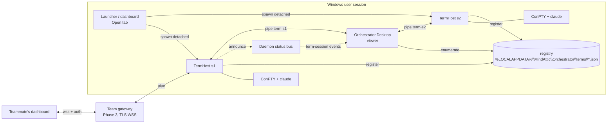

# Spike: CLIs that live outside the dashboard (M.ORCH-T922)

**Question.** Can each CLI live in memory outside Orchestrator.Desktop, so that the dashboard only shows an exact copy of it
and sends keys back? The goal is that the dashboard can crash, restart or redeploy without killing any CLI. Later, the
same copy could be shown to teammates as a "pixel perfect screenshare" of each person's real CLI.

**Short answer.** Yes. Every piece we need is either already in our dependencies or is a well-worn pattern (tmux, VS
Code's pty host). The renderer we use today, `Microsoft.Terminal.Wpf.TerminalControl`, takes any `ITerminalConnection`.
It does not care whether the bytes come from a local ConPTY or from a pipe to another process. I compiled a relay
connection against the exact package versions we ship (see section 2).

---

## Recommendation (read this first)

1. **Use the dtach model, not a tmux-style server.** Build one small, stable host executable, `MindAttic.Orchestrator.TermHost`,
   and run **one host process per CLI**. Each host owns exactly one ConPTY and one CLI, keeps a replay buffer, and serves
   one per-user named pipe. A crash in one host kills one CLI, never all of them. An upgrade never touches running
   sessions: old sessions keep the binary they started with, and new sessions start on the new one. This removes the
   "upgrade the host without killing sessions" problem rather than solving it.
2. **The dashboard becomes a viewer.** Each tab is a bare `TerminalControl` driven by a `RelayConnection : ITerminalConnection`
   that talks to that session's pipe. EasyWindowsTerminalControl drops out of the viewer, because it always spawns a local
   process. The keyboard, focus, copy and paste work (T852, T846, T824, T866, T867, T868) all lives on the viewer side and
   carries over almost unchanged. Only paste's write target changes.
3. **Phase 1 is the smallest change that ends "a dashboard crash kills every CLI".** It needs TermHost, a session registry,
   the relay viewer, and a late-attach replay built from a raw output ring plus tracked terminal modes. Estimate about
   2 weeks of focused work. After it lands, a dashboard crash or redeploy costs a 1 to 2 second reattach, not a
   `claude --resume`.
4. **Exact snapshots come in Phase 2**, from a headless VT emulator in the host (libghostty-vt first, vtnetcore as the
   managed fallback). Phase 2 also adds several viewers per session with a clear owner of the session's size.
5. **Team viewing comes in Phase 3**, through a TLS WebSocket gateway behind MindAttic.Authentication. Access is read-only
   by default, with per-member grants from `orchestrator.db` and an audit log. Anything on a CLI's screen is broadcast to
   its watchers, secrets included, and section 5 deals with that.
6. **Claude's own `/remote-control` and `stream-json` are useful companions, not a substitute.** They show a structured
   conversation, not the TUI, and they only work for Claude. Keep them for phone and low-bandwidth use (section 6).

```
 TODAY                                         PROPOSED
 ┌──────────── Orchestrator.Desktop ───────┐   ┌──────── Orchestrator.Desktop (viewer) ──────┐
 │ TerminalControl ── TermPTY ── ConPTY ─┐ │   │ TerminalControl ── RelayConnection ─┐       │
 │ TerminalControl ── TermPTY ── ConPTY ─┤ │   │ TerminalControl ── RelayConnection ─┤       │
 │ ... x12                               │ │   └─────────────────────────────────────│───────┘
 └───────────────────────────────────────│─┘        named pipes (per user, per session)
   dashboard dies => pipes close =>      │     ┌──────────────┐ ┌──────────────┐ ┌──────────────┐
   conhost exits => every claude dies    │     │ TermHost #1  │ │ TermHost #2  │ │ TermHost #12 │
                                         ▼     │ ConPTY+ring  │ │ ConPTY+ring  │ │ ConPTY+ring  │
                                   claude.exe  │  claude.exe  │ │  claude.exe  │ │  claude.exe  │
                                               └──────────────┘ └──────────────┘ └──────────────┘
                                                 dashboard dies => hosts keep running; reattach
```

---

## 0. Today, from the code

- `src/MindAttic.Orchestrator.Wpf/ViewModels/TerminalsViewModel.cs`: each `TerminalPaneViewModel` builds an `EasyTerminalControl`
  with `StartupCommandLine = request.ProcessCommandLine(pipeName)`. That control creates a `TermPTY`, which calls
  `CreatePseudoConsole` and starts PowerShell, then `MindAttic.Launcher host …`, then `claude`, all inside the dashboard
  process. Every ConPTY's pipe handles belong to the dashboard. When the dashboard dies, the pipes break. Conhost then sends
  its clients a close event and the whole tree exits. That is the 2026-10-25 failure: two crashes, every CLI lost.
- `src/MindAttic.Orchestrator.Core/Sessions/TerminalPanes.cs`: `PaneBroker` is the dashboard's per-user pipe
  (`mindattic-orchestrator-terminals-<user>`, `PipeOptions.CurrentUserOnly`). The Launcher (M.LNCH-T77) sends a
  `PaneRequest` down it as one line of JSON. When nobody is listening, the Launcher falls back to a Windows Terminal window.
- `MindAttic.Launcher host` (`Commands/HostAgentCommand.cs`) does **not** own a PTY. It resolves the project, sets the title
  and runs the agent with inherited stdio. Today the dashboard is the only PTY owner.
- `src/MindAttic.Orchestrator.Wpf/SessionRestore.cs` (T862) writes every tab's Claude session continuously. After an unclean
  exit, the next start offers `claude --resume`. That recovers the conversation, but not the process: in-flight tool calls,
  the running bash, the scroll position and the half-typed prompt are all lost.
- `run.ps1` (T873) refuses to install while any hosted CLI is busy, because an install restarts the dashboard.
- `Daemon.cs` is the always-on logon job (status bus T854/T872, app bus T879/T891). It changes often, so it is a poor
  home for something that must never restart (section 7).

## 1. Architecture: who owns the PTY

### Prior art

| System | Who owns the PTY | What a late viewer gets | Size with several viewers | Transport and auth | Runs on Windows natively | What to borrow |
|---|---|---|---|---|---|---|
| **tmux** | One server per user owns every pane's pty and keeps its own emulator grid per pane | Server re-renders the grid for each client's terminal | `window-size` option: `largest`, `smallest`, `manual`, `latest` (follows the most recently active client) | Unix socket, filesystem permissions | No (WSL/Cygwin only) | Emulator per pane; a server-side redraw; a size policy chosen per window |
| **GNU screen** | One server process per session | Redraws from its own screen copy | Smallest attached display wins | Unix socket; multiuser ACLs (`acladd`, `aclchg`) for read-only users | No | Per-user ACLs, including read-only watchers |
| **dtach / abduco** | **One tiny process per session**; no emulator | dtach: nothing (a redraw trick such as Ctrl+L or SIGWINCH); abduco: same | One owner | Unix socket | No | **The process model**: one session per process, so a crash or upgrade is isolated |
| **WezTerm mux** (`wezterm-mux-server`) | Mux server owns panes; GUI is a client | Server holds the terminal model and sends lines and changes, not raw bytes | Per-client | "Unix domains" (also on Windows), SSH domains, TLS domains with bootstrap over SSH | **Yes**, including Unix domains on Windows | Proof that a mux server with a separate GUI client works on Windows; the TLS domain bootstrap idea |
| **Zellij** | Server per session; clients attach | Server-side state, re-rendered | Per-client | Unix socket; recent versions add a web client with login tokens | Not natively | A web client with token login for remote viewers |
| **Windows Terminal** | Each window process owns its ConPTYs | Persisted layout restores the *text* of buffers on restart, not the processes | n/a | n/a | Yes | Nothing for detach (it has none); `ITerminalHandoff` shows a conhost session *can* move between processes (section 7) |
| **tmate** | tmux fork; a relay server mirrors the session | Relay replays the tmux state | tmux rules | SSH to the tmate relay; separate read-only and read-write URLs | No | **Separate read-only and interactive join links** |
| **upterm** | Host CLI owns the pty; uptermd relays over reverse SSH | Live stream only | Host's size | SSH; `--authorized-keys`, `--github-user`; `--read-only` | Partial | **Identity-pinned joiners and a read-only flag** |
| **tty-share** | Host owns the pty; a proxy relays over WebSocket; xterm.js in the browser | Live stream | Host's size | HTTPS/WebSocket; read-only flag | Partial | Browser viewer over a WebSocket |
| **VS Code pty host** | A separate `ptyHost` process owns every pty; windows are clients | A per-terminal `@xterm/headless` instance records all output. On reconnect, `@xterm/addon-serialize` produces a replay event (cols, rows and serialized VT data) | Last attached window | Local IPC; a heartbeat restarts a hung host | Yes | **Headless emulator plus serialize-on-attach**; orphan detection with grace timers; buffered output; flush before a resize |

**What VS Code does, from its source** (`src/vs/platform/terminal/node/ptyService.ts`):

- `PtyService` keeps a `PersistentTerminalProcess` per id.
- Each one owns an `XtermSerializer`, which feeds every data event into an `@xterm/headless` `Terminal` with the session's
  cols, rows and a scrollback limit taken from `reconnectConstants`.
- `generateReplayEvent()` loads `@xterm/addon-serialize` and emits `{cols, rows, data}`. It can exclude the alternate
  buffer and modes (`normalBufferOnly`).
- On disconnect, `detach()` arms a grace timer (`graceTime`, cut down to `shortGraceTime` by `reduceConnectionGraceTime`),
  after which an unclaimed pty is shut down.
- Orphan detection asks the windows "is this yours?" (`_onProcessOrphanQuestion`). It waits on an `AutoOpenBarrier(4000)`
  and treats no reply within 500 ms of the check as orphaned.
- Output goes through a `TerminalDataBufferer`, and `resize()` flushes it first.

Phase 2 copies this design almost exactly, with one change. VS Code runs **one** pty host for all terminals and pays for
it with a heartbeat-and-restart system. Per-session hosts make that unnecessary.

### The shape for MindAttic



**Host candidates, compared:**

| Option | Verdict |
|---|---|
| The dashboard (today) | Rejected: it is the process that crashes and gets redeployed |
| The daemon | Rejected as the PTY owner: it is redeployed with every Orchestrator change, and a hang in it would freeze every CLI. It stays the **registry and announcer** on the status bus |
| The Launcher | Close, because `Launcher host` already runs once per tab. But the Launcher is a Spectre CLI with a menu and its own release cadence, and it runs inside the PTY rather than owning it. It stays the **requester** |
| One shared TermHost server (tmux style) | Workable, but needs ConPTY handle handoff to upgrade without losses, and one bug kills all sessions |
| **One TermHost per session (dtach style)** | **Chosen.** About 10 to 15 MB extra per session as NativeAOT (section 7). Isolation and upgrade-by-attrition come free |
| A Windows service | Rejected: it would run in session 0. Spawning claude into the user's desktop needs `CreateProcessAsUser` and token juggling, and `claude /login` opens a browser, which needs the interactive session. Use a per-user process started like the daemon instead |

**Lifetime rules for TermHost:**

- It is started *detached*: `CREATE_NEW_PROCESS_GROUP | DETACHED_PROCESS | CREATE_BREAKAWAY_FROM_JOB`, falling back to a
  plain detached start when the parent's job forbids breakaway. Its parent is never the dashboard's job, so a dashboard
  crash, or a debugger or Windows Terminal job closing, cannot take it down.
- It exits when its CLI exits, after a grace period so a viewer can read the last lines. The default is 10 minutes after
  exit if no viewer is attached, and immediately once a viewer closes the tab.
- An idle session with no viewer stays alive indefinitely. That is the whole point. Orphan handling is in section 7.

## 2. The viewer in .NET and WPF: can `TerminalControl` be driven remotely? **Yes.**

From the decompiled `CI.Microsoft.Terminal.Wpf 1.25.260303002` and `EasyWindowsTerminalControl 1.0.38` (made with ilspycmd
into the spike's scratch directory):

```csharp
public interface ITerminalConnection {           // Microsoft.Terminal.Wpf
    event EventHandler<TerminalOutputEventArgs> TerminalOutput;  // backend -> renderer (VT text)
    void Start();                                 // called when the connection is set
    void WriteInput(string data);                 // renderer -> backend (keys, already VT-encoded)
    void Resize(uint rows, uint columns);         // renderer computed a new grid
    void Close();
}
public partial class TerminalControl : UserControl {
    public ITerminalConnection Connection { set; } // any implementation
    public bool AutoResize { get; set; }
    public Task ResizeAsync(uint rows, uint columns, CancellationToken ct); // fixed grid (non-owner viewers)
    public string GetSelectedText();
    public void SetTheme(TerminalTheme theme, string fontFamily, short fontSize, Color externalBackground = default);
    public int Rows { get; } public int Columns { get; }
}
```

`TerminalContainer` (the `HwndHost`) shows the whole contract:

- **Output:** `connection.TerminalOutput += …` leads to `NativeMethods.TerminalSendOutput(terminal, e.Data)`. That is a
  plain string of VT and can arrive from any thread, which is what `TermPTY` does today.
- **Input:** the native control's write callback calls `OnWrite(data)` and then `Connection?.WriteInput(data)`. Keys arrive
  already encoded as VT. Because EasyWindowsTerminalControl sends `ESC[?9001h` to the renderer, they are **win32-input-mode**
  sequences (`ESC[Vk;Sc;Uc;Kd;Cs;Rc_`), which ConPTY decodes back into full key events. The relay passes them through
  unchanged.
- **Resize:** the renderer calls `Connection?.Resize(rows, cols)` whenever its grid changes (`AutoResize`), or on
  `ResizeAsync`.
- **Setting `Connection`** first writes `ESC c ESC]104 ESC\` (a full reset) to the renderer, then calls `Start()`. **A
  reattach therefore always starts from a blank screen.** The connection must replay the snapshot *after* `Start()`, then
  stream live output.

`EasyTerminalControl` is a thin wrapper: theme, `InputCapture` keyboard navigation, a `Terminal` property, and `TermPTY`.
`TermPTY` is itself just an `ITerminalConnection` over ConPTY. But `EasyTerminalControl.TermInit` starts a local process
from `StartupCommandLine` on `Loaded`, and `TermPTY.Start(...)` is not virtual. So the viewer should host a **bare
`TerminalControl`** inside our own small `RelayTerminal` control. It copies the about 40 lines we use from
EasyTerminalControl: the theme with the font, `KeyboardNavigation` contained for Tab and arrows, focus forwarding, and
sending `ESC[?9001h` to the renderer after each (re)connect.

**Compile check.** The scratch project `relayprobe` (net10.0-windows, EasyWindowsTerminalControl 1.0.38) builds cleanly
with:

```csharp
public sealed class RelayConnection(Stream stream) : ITerminalConnection
{
    public event EventHandler<TerminalOutputEventArgs>? TerminalOutput;
    public void Start() => Task.Run(async () => { /* read frames; TerminalOutput?.Invoke(this, new(text)) */ });
    public void WriteInput(string data) { /* send an Input frame */ }
    public void Resize(uint rows, uint columns) { /* send a Resize frame (owner only) */ }
    public void Close() => stream.Dispose();
}
// Bare:    new TerminalControl { Connection = new RelayConnection(pipe) };
// Swapped: easy.DisconnectConPTYTerm(); easy.Terminal.Connection = new RelayConnection(pipe);
```

The "swapped" form works too, but it races `EasyTerminalControl`'s own start-on-load, so the bare control is cleaner.
Behaviour at run time (resize, win32-input-mode, replay after the reset) is the first follow-up ticket. That prototype was
not run here because it needs a visible window, and the spike must not disturb the running dashboard.

## 3. State on attach: screen, scrollback and modes

A viewer that attaches late, or reattaches after a crash, needs four things:

- the visible screen,
- the scrollback,
- the terminal modes the CLI turned on,
- the cursor.

### Option A: a raw replay ring (Phase 1)

The host keeps the raw UTF-8 VT output in a bounded ring (4 MB per session by default). It **resets the ring's start** at
every full clear the CLI emits (`ESC c`, or `ESC[2J` together with `ESC[3J`). It also tracks a small set of **sticky
modes** by scanning output, the way `TerminalPaste.Scan` already watches bracketed paste:

| Mode | Sequence |
|---|---|
| Bracketed paste | `?2004` |
| Cursor visibility | `?25` |
| Alternate screen | `?1049`, `?47`, `?1047` |
| Application cursor keys | `?1` |
| Mouse tracking | `?1000`, `?1002`, `?1003`, `?1006` |
| Focus events | `?1004` |
| Synchronized output | `?2026` |
| Window title | OSC 0/2 |

On attach, the host sends this to the viewer:

1. the replay frame: ring contents, then the current modes re-asserted, then a cursor-position report;
2. a "live" marker;
3. the live stream.

The host serializes "copy ring" and "subscribe" under one lock, so no byte is lost or doubled between them.

- **Pros:** about 300 lines; no third-party emulator; exact for Claude Code's normal, inline rendering as long as the
  viewer's grid equals the session's (the host enforces that, see "Resize").
- **Cons:** if the session was resized in the past, replaying older bytes at the current size can garble earlier
  scrollback. Ink-style TUIs rewrite their live region with cursor-up and erase, so replay costs CPU proportional to the
  bytes, not to the screen. In practice the WT renderer handles a few MB in well under a second. After the ring wraps,
  the oldest scrollback is gone.
- **Cheap fix-up:** after the replay, the host nudges the ConPTY with resize (cols-1), then resize (cols). Claude Code
  and other TUIs redraw their live region on resize, so whatever the replay got wrong in the visible area is repainted
  correctly. (dtach users rely on the same trick: Ctrl+L or SIGWINCH.)

### Option B: a headless VT emulator in the host (Phase 2)

This is what VS Code and tmux do. The host feeds every output chunk to an in-memory emulator. On attach it **serializes
the emulator's state** into a compact VT stream, `{cols, rows, data}`, that recreates scrollback, screen, attributes,
cursor and modes exactly at the current size. Candidates:

| Engine | Language | Fit |
|---|---|---|
| **libghostty-vt** | Zig, with a C API; no libc dependency; builds for Windows | Best fidelity, proven by Ghostty. Its C API signatures are still in flux, so pin a version and P/Invoke it from TermHost. **First choice; chosen in T929** (see "Phase 2 decisions") |
| libvterm | C | Mature (Neovim uses it). Needs our own serializer, has no reflow, and its scrollback is callback-based |
| vtnetcore (VtNetCore.XTermParser) | C# | Managed, so no native build, but old and lightly maintained. **Fallback** |
| @xterm/headless + addon-serialize | JS | Exactly VS Code's path, but drags Node into every host. Rejected |
| Windows Terminal's own buffer | — | `Microsoft.Terminal.Wpf` exposes no buffer read (only `GetSelectedText`), and conhost's console API (`ReadConsoleOutputW` after `AttachConsole`) returns legacy 16-color attributes, which loses 24-bit color. Rejected for snapshots |

### Alternate-screen TUIs

Claude Code normally renders **inline in the main buffer**: its transcript scrolls into scrollback and its live region is
redrawn in place. Full-screen programs it may run (`less`, `vim`, a fullscreen rendering mode where one is enabled) switch
to the alternate screen with `?1049h`.

- **Option A** handles this correctly as long as the ring still holds the `?1049h` and everything after it. Mode tracking
  guarantees the viewer ends up on the right buffer.
- **Option B** serializes both buffers and the active one. Like VS Code's `normalBufferOnly`, a viewer can choose to see
  just the normal buffer.

### Resize ownership with several viewers

ConPTY has one size, so one party must own it.

| Policy | Behaviour | Verdict |
|---|---|---|
| tmux `smallest` | Every viewer gets the smallest grid | Penalizes the main user whenever a teammate watches from a laptop |
| tmux `latest` | The most recently active client sets the size | Good locally |
| **Per-session owner** | The **interactive viewer that last sent input or took focus** owns the size; its `Resize` frames are applied. Every other viewer runs `TerminalControl.AutoResize = false` with `ResizeAsync(session rows, cols)` and letterboxes. Read-only remote watchers can never change the size. A viewer can explicitly "Take size" | **Chosen** |

The host broadcasts a `size` frame on every change, so viewers that don't own the size follow it. Like VS Code, the host
flushes buffered output before applying a resize.

## 4. Input, focus and clipboard

All of these stay **in the viewer**, because they are about how WPF routes keys around a native child window:

| Work | Today | After |
|---|---|---|
| T852 navigation keys posted to the terminal's HWND | `TerminalKeyboard` | Unchanged: the same `HwndHost` |
| T846 binding gate and focus return | `TerminalKeyboard.GateBindings`, `MainWindow` | Unchanged; `HoldsFocus` looks for `RelayTerminal` instead of `EasyTerminalControl` |
| T824 Ctrl+Left/Right tab switching | `PersonTerminalsViewModel` | Unchanged |
| T867/T866 copy and cut with a selection | `TerminalControl.GetSelectedText()` | Unchanged: the selection is local to the renderer |
| T868 paste | `term.WriteToTerm(payload)` on the local `TermPTY`; bracketed mode from `InterceptOutputToUITerminal` | `connection.WriteInput(payload)`. The bracketed flag comes from the host's tracked modes (sent on attach and on change), not from scanning output in the viewer, so a reattached viewer knows the mode at once |

**Key relay.** The renderer produces win32-input-mode VT (since `?9001h`), and the viewer sends it as an `Input` frame. The
host writes it unchanged to the ConPTY input pipe, which decodes it into `KEY_EVENT_RECORD`s for claude. Ctrl+C reaches
claude as a key event, exactly as today. Nothing is re-encoded, so behaviour is identical.

**Paste.** The viewer builds the payload with `TerminalPaste.Payload(text, bracketed)`: CRLF and LF become CR, and the text
is wrapped in `ESC[200~` and `ESC[201~` when bracketed. It sends one `Input` frame. Large pastes are chunked at 64 KB per
frame, and the host writes the frames in order. With several interactive viewers, input is *merged* (tmux semantics). The
UI shows a "someone else is typing" hint when two viewers sent input within 2 seconds.

**Focus events (`?1004`).** Send `ESC[I` and `ESC[O` from the size-owning viewer only. Otherwise every watcher's focus
change reaches the CLI.

## 5. Transport and security

### Locally: a separate pipe per session, not the status bus

The status bus (`docs/app-bus.md`, `Core/Status/AppBus.cs`) is NDJSON fan-out through the daemon. It is the right place to
**announce** sessions: a new `term-session` kind (v1) with `{id, pid, pipe, title, login, repo, cols, rows, state}`,
published when a host starts, ends or changes title. It is the wrong place for **terminal bytes**:

- it hops through the daemon;
- it JSON-escapes every byte;
- heartbeat and backpressure rules shared with tickets would let one chatty CLI delay everything;
- the daemon restarts on every deploy.

So each host serves **its own pipe**, `mindattic-term-<user>-<sessionId>`, with `PipeOptions.CurrentUserOnly` like
`PaneBroker`, using a small binary framing:

```
frame := u8 kind | u32 length | payload
kinds:  Hello{protocol, viewerId, interactive, cols, rows}   viewer -> host
        Replay{cols, rows, modes, data}  Live  Output{data}  Size{cols, rows}  Modes{...}
        Title{text}  Exit{code}          host -> viewer
        Input{data}  Resize{cols, rows}  TakeSize  Ping       viewer -> host
```

The registry is one JSON file per live host, so a viewer can find sessions even when the daemon is down. The status-bus
announcement is the fast path; the files are the truth.

### Bandwidth and latency for a dozen live TUIs (estimates)

| Activity | Rate per session | x12 |
|---|---|---|
| Claude idle at the prompt | ~0 | ~0 |
| Working (spinner, token counter, about 10 redraws per second of a 1 to 3 line region) | 1 to 3 KB/s | 12 to 36 KB/s |
| Streaming a long answer or tool output | 5 to 30 KB/s | up to ~360 KB/s if all burst at once |
| Full repaint (resize or attach, 120x40 with 24-bit color) | 15 to 40 KB once | — |
| Attach replay (Option A ring) | up to 4 MB once; typically <500 KB | — |

- **Locally:** pipe latency is under 1 ms, so keystroke echo looks the same as today.
- **On a LAN with TLS:** add 1 to 5 ms.
- **Over the internet:** add the round trip time (RTT). Interactive typing is fine up to about 100 ms; past that, prefer
  read-only.
- Compress remote streams with `permessage-deflate` on the WebSocket. VT compresses 5 to 10x.

### Team viewing across machines (Phase 3)

```
Ryan's PC                                             Teammate's PC
TermHost x N ─pipe─ Gateway (ASP.NET Core, Kestrel) ─wss/TLS─ Dashboard viewer (RelayConnection over WebSocket)
                     │  MindAttic.Authentication (login, TOTP)
                     │  ACL from orchestrator.db (members, org_members)
                     └  audit log
```

- **Placement.** The gateway is a per-machine service that bridges local pipes. A central relay (as tmate and upterm use)
  would only be needed across NAT; Tailscale or a VPN avoids that for a small team.
- **TLS** with a certificate the team trusts. Alternatively, copy WezTerm's TLS domain idea and bootstrap a pinned
  certificate over an already-authenticated channel.
- **Authentication.** MindAttic.Authentication is an ASP.NET Core Razor Class Library (Argon2id, TOTP, lockout, audit), so
  the gateway can host it directly. A viewer signs in once and holds a short-lived token for its WebSocket connections.
- **Authorization.** `orchestrator.db` has `members(email, role, …)` and `org_members(provider, login, org_id, person)`.
  Add a `term_grants(owner, viewer, level, expires_utc)` table, where `level` is `watch` or `interact`.
  - Default: members of the same org may **watch**. **Interact** must be granted explicitly, per person or per session,
    with an expiry.
  - The owner sees a "being watched by …" banner, as screen's `acladd`, tmate's separate read-only and read-write links,
    and upterm's `--read-only` with `--github-user` all do.
- **Secrets on screen are broadcast.** API keys echoed by a command, `.env` files Claude reads, and tokens in tool output
  all go out byte for byte. A "pixel perfect" copy cannot be selectively blind. Mitigations:
  1. Remote watching is opt-in per session, not global.
  2. Remote streams go through an optional **masker**. It replaces runs matching known token shapes (`sk-ant-…`,
     `ghp_…`, AWS key ids, JWTs, Vault-sourced values) with `•••` **before** the bytes leave the machine. That breaks
     exactness only where a secret was.
  3. A one-keystroke "pause broadcast" on the owner's side.
  4. The audit log records who attached when, and every remote `Input` frame.

  The masker never applies to the local viewer.

## 6. Claude-specific alternatives

| Approach | What it gives | Against "pixel perfect" |
|---|---|---|
| **`/remote-control`** (`claude remote-control`, alias `/rc`) | A local session driven from claude.ai/code or the mobile app; execution stays local; push notifications. We already rely on it (it replaced MindAttic.Mobile) | Structured conversation, not the TUI; Claude only; needs Anthropic's relay; off by default on Team plans until an admin enables it; one session at a time per link. **Complements** the host: run it inside a hosted CLI for phone access |
| **`claude --resume`** after a host restart (T862) | Conversation continuity | Loses the process, its children and in-flight work. Stays as the **fallback** for a host that dies, as today |
| **Headless** `claude -p --output-format stream-json --input-format stream-json`, or the Agent SDK | Machine-readable events (messages, tool calls, results); trivial to broadcast and to render as cards; tiny bandwidth; easy to redact | Not the real CLI. No slash-command UI, permission prompts look different, and our hooks and statusline behave differently. Codex and other providers need their own adapters. Only useful for a **summary view** ("what is everyone doing") beside the real terminal |

**Verdict.** Mirror the real TUI, which is what the user asked for and works for every provider. Optionally add a
structured activity feed later for the team wall and for phones. The daemon already sees each CLI's state through its
hooks, which is a cheap source for that feed.

## 7. Failure modes

| Failure | Today | After |
|---|---|---|
| Dashboard crash or redeploy | Every CLI dies | No CLI dies; the dashboard reattaches from the registry on start (about 1 to 2 s) |
| One TermHost crashes | n/a | **One** CLI dies (its ConPTY closes); T862's `--resume` offer covers that tab only. TermHost is small (pipe server, ring, ConPTY), so the crash surface is far smaller than WPF's |
| TermHost upgrade | n/a | Install side by side: `TermHost\<version>\`. New sessions use the newest, running ones keep theirs, and the folder of a version is deleted once no process runs from it. The protocol is versioned in `Hello`, and a viewer speaks every version still running |
| ConPTY handle handoff (stretch) | n/a | Possible in principle. A ConPTY is anonymous pipes plus a signal pipe, a reference handle and the conhost process; Windows Terminal's default-terminal `ITerminalHandoff` hands a live conhost session to another process, and node-pty is gaining an option to adopt `{input, output, signal, ref, server, client}`. But `HPCON`'s internals are undocumented. **Not needed** with per-session hosts; revisit only if one shared host is ever chosen |
| Orphaned sessions (no viewer, CLI waiting forever) | n/a | A session is never killed for lacking a viewer. The dashboard shows it, with a "Detached" badge per person. The daemon reports sessions idle for more than N hours (a setting) on the status bus. A host whose CLI exited lingers 10 minutes, then exits |
| Stale registry entries | n/a | Each entry holds the host's pid and start time; a viewer drops one whose process is gone or was reused |
| Memory per session | ConPTY and buffers inside the dashboard | conhost 5 to 10 MB; TermHost about 10 to 15 MB (NativeAOT) or 30 to 40 MB (JIT); ring 4 MB; Phase 2 emulator with 10k lines x 120 cols about 9 MB plain, 25 MB worst case (measured in T929). Claude itself (300+ MB) dominates either way. About 40 to 60 MB of overhead per session, or about 0.5 to 0.7 GB for a dozen |
| Logoff, reboot | Everything dies | Everything still dies: the hosts are per-user processes. Keep T862's restore file, now written by each host, so the next logon offers `--resume` for each. A Windows service in session 0 could survive logoff but not run claude in the user's desktop; rejected in section 1 |
| Sleep, hibernate, RDP reconnect, lock | Fine | Fine: no process changes |
| Dashboard running from a job object (debugger, CI) | n/a | Hosts are started with breakaway, or by a broker that isn't in the job (the daemon's `spawn-term` inbox kind), so they don't die with the dashboard's job |
| Two dashboards attached | Impossible | Supported: both stream; the size goes to its owner (section 3) |

**How is this better than today if a host can still crash?** It narrows the blast radius from 12 CLIs to 1, and it moves
the PTY out of the most complex, most often redeployed process (a WPF app with a dozen `HwndHost`s and timers) into the
simplest, most rarely changed one. It also ends the T873 tension: a dashboard deploy no longer needs every CLI to be idle.

## 8. Phased plan

| Phase | Goal | Effort | Ends |
|---|---|---|---|
| **0. Prove it** | A scratch WPF window with a bare `TerminalControl` and a `RelayConnection` to a stub host that owns a ConPTY running `claude`; kill and restart the viewer; check win32-input-mode, Ctrl+C, paste, resize, replay after the reset | 1 to 2 days | Unknowns about the renderer |
| **1. Survive the dashboard** | TermHost per session, registry, relay viewer, ring replay with mode tracking, deploy decoupling | ~2 weeks | **"A dashboard crash kills every CLI"** |
| **2. Fidelity and many viewers** | Headless emulator snapshot, size ownership, pop-out viewers, versioned host install | 2 to 3 weeks | Garbled late attach; one viewer per CLI |
| **3. Team screen-share** | TLS WebSocket gateway, auth, ACL, audit, masking, a team wall | 3 to 5 weeks | "Can't see what everyone is doing" |
| **4. Optional** | A structured activity feed for phones and the wall | 1 week | — |

**Follow-up tickets** (filed unapproved, each a follow-up of M.ORCH-T922):

Phase 0
- M.ORCH-T923: Prototype a relay viewer: a bare TerminalControl with a pipe-fed ITerminalConnection against a stub ConPTY host; verify keys, paste, resize and replay after a viewer restart.

Phase 1
- M.ORCH-T924: TermHost: a detached per-CLI process that owns one ConPTY and serves a per-user, per-session named pipe (framed output, input, resize, exit), outliving the dashboard.
- M.ORCH-T925: Session registry and discovery: hosts register under %LOCALAPPDATA% and announce a term-session kind on the status bus; the dashboard reattaches on start.
- M.ORCH-T926: Dashboard viewer: Terminals tabs use a RelayTerminal (bare TerminalControl and RelayConnection) instead of EasyTerminalControl; port T852, T846, T824 and T866 to T868.
- M.ORCH-T927: Late-attach replay: a raw output ring reset at full clears, with sticky-mode tracking and a redraw nudge, so a reattached viewer shows the current screen.
- M.ORCH-T928: Deploy and restore: installs never stop TermHosts, the T873 idle gate applies only to unhosted CLIs, and T862 restore covers only sessions whose host died.
- M.LNCH-T82: Launcher opens CLIs through a TermHost when no dashboard is listening, so they appear on the dashboard's next start instead of in a Windows Terminal window.

Phase 2
- M.ORCH-T929: Headless VT emulator in TermHost (libghostty-vt first, vtnetcore as fallback) for exact screen and scrollback snapshots on attach.
- M.ORCH-T930: Multi-viewer size policy: the interactive viewer that last sent input owns the size, others letterbox, and a viewer can take the size explicitly.
- M.ORCH-T931: Pop-out and second-instance viewers: open any hosted CLI in another window, read-only or interactive, alongside its tab.
- M.ORCH-T932: Versioned TermHost protocol and side-by-side installs: running sessions keep their host binary, and old versions are cleaned up once unused.

Phase 3
- M.ORCH-T933: Team gateway: an ASP.NET Core TLS WebSocket service that bridges local TermHost pipes to authenticated remote viewers.
- M.ORCH-T934: Viewing ACL and audit: watch and interact grants from members and org_members, read-only by default, every attach and remote input logged.
- M.ORCH-T935: Broadcast secret hygiene: an opt-in masker for token-shaped strings on remote streams, a "being watched" banner and pause broadcast.
- M.ORCH-T936: Team wall: a dashboard grid of every member's live CLIs through the gateway.

Phase 4
- M.ORCH-T937: Structured activity feed: evaluate stream-json, hooks and Remote Control as a low-bandwidth "what is everyone doing" view beside the real terminals.

## Phase 0 results (M.ORCH-T923, 2026-10-26)

`prototypes/T923-relay/`: a TermHostStub (one ConPTY per detached process, 4 MB ring, sticky modes, per-session pipe) and a RelayViewer (a bare `TerminalControl` driven by a `RelayConnection`). It was tested against a live `claude` session and a Windows PowerShell session. Keys were sent with a pipe client using the renderer's own win32-input-mode encoding, and every result was checked through the viewer's screen.

**Verdict: GO for Phase 1.** All seven checks pass.

| Check | Result |
|---|---|
| 1. Attach and render | Pass. The real Claude TUI shows pixel-identical in the viewer |
| 2. Keys (typing, Home/End/Left, Backspace, Enter, Ctrl+C) | Pass. `cho abcdef` + Home `e` + End `Z` Backspace + Left Left `X` + Enter printed `abcdXef`, and Ctrl+C broke a stuck prompt |
| 3. Paste | Pass. A two-line paste reached Claude bracketed (the host tracked `?2004`) and was not submitted |
| 4. Resize | Pass. Resizing the window took the host to 80x23, and Claude reflowed |
| 5. Reattach mid-work | Pass. Output kept going with no viewer attached; on reattach the missed lines replayed, then the stream continued live. A half-typed Claude prompt survived the viewer closing |
| 6. Viewer force-killed | Pass. Both hosts survived, and a new viewer process reattached to the exact screen |
| 7. CLI exit | Pass. The viewer shows the exit code, and the host lingers 60 s, then exits |

**Bugs found and fixed in the prototype (carry these into Phase 1):**

1. **Deadlock on connect.** Raising `TerminalOutput` from the pipe's reader thread while the renderer resizes on the UI thread froze the viewer. `RelayConnection` now captures the UI `SynchronizationContext` in `Start()` and posts output to it, in order. T926 must do the same.
2. **Stale host size.** The renderer reports its grid before the connection exists, so the host stayed at the Hello default and Claude drew for the wrong size. The viewer now sends the terminal's actual rows and cols right after setting `Connection`.
3. **Navigation keys.** WPF keyboard navigation swallows arrows, Home/End and PgUp/PgDn before the native renderer sees them (the T852 problem). Posting `WM_KEYDOWN` to the renderer's HWND lost and reordered keys. Sending them as win32-input-mode sequences through the connection is deterministic. T926 should use that rather than T852's PostMessage.
4. **Use the bundled ConPTY.** The host now imports `CreatePseudoConsole` and its siblings from `conpty.dll` (`Microsoft.Windows.Console.ConPTY` 1.24.260710001), the same one the app gets through EasyWindowsTerminalControl, instead of kernel32's inbox copy.

**Open items for Phase 1:**

- **Replay garbling.** A replay at a different size than the session's history (attach at 118x32 after 120x30 output) duplicates or clips some earlier lines. The visible TUI region repaints correctly after the redraw nudge. This is expected for Option A; Phase 2's emulator (T929) removes it (done: see "Phase 2 decisions").
- **Bad command crashes the host.** A command that isn't found (`pwsh` isn't installed on this machine, yet it's the host's default) crashed the host with an unlogged Win32Exception. T924: log and exit cleanly, and default to `powershell.exe` when `pwsh` is missing.
- **PSReadLine prompt overwrite.** When a prompt wraps exactly at the edge, PSReadLine's redraw overwrote the trailing `>`. It's cosmetic and the same in a plain terminal.
- **One viewer at a time.** A second connection replaces the first. Multi-viewer support is T930 (done: see "Several viewers").

## Phase 1 interfaces

What M.ORCH-T925 built for the dashboard viewer (M.ORCH-T926). `TermSessionRecord`, `TermSessions` and `TermBus` live in
`src/MindAttic.Orchestrator.Term`, the dependency-free library the host, Core and the WPF app all reference.
`TermLauncher` lives in Core (`Sessions/TermLauncher.cs`).

**The record.** `TermSessionRecord` has `Id`, `HostPid`, `HostStartUtc`, `Pipe`, `Title`, `Login`, `ConfigDir`, `Repo`,
`Cwd`, `CommandLine`, `Cols`, `Rows`, `State` (`TermSessionStates.Running` or `Exited`), `ExitCode`, `StartedUtc` and
`Protocol`. `Exited` is a convenience property.

**The registry: the files are the truth.**

- Each host writes `%LOCALAPPDATA%\MindAttic\MindAttic.Orchestrator\terms\<id>.json` (`TermSessions.PathOf(id)`), beside
  its `<id>.log`. The write is atomic: a temporary file is renamed over the record.
- The host writes the file once it owns its pipe and before its CLI starts. It rewrites the file when the title, size or
  state changes, and deletes it as it exits.
- A host that is killed leaves its file behind. Readers prune it.
- `TermSessions.Enumerate()` returns the live sessions, oldest first, including exited CLIs whose host still lingers. It
  drops and deletes every record whose `HostPid` is gone or now belongs to a process with another start time (a reused
  pid). It also deletes unreadable files and leftover temporary files once they are a minute old. It needs no daemon.
- `TermSessions.Get(id)` returns one live session, or null after pruning it.
- `TermSessions.HostStartOf(pid)` is the liveness probe that both use.

**The bus (fast path).** Kind `term-session` (`TermBus.Kind`) is at v1 (`TermBus.Version`). Its payload is a
`TermSessionEvent`: the record plus `Event`, which is `TermSessionEvents.Started`, `Changed` or `Ended`. The host sends it
to the daemon's inbox with a 50 ms timeout, on a worker thread, and the daemon relays it. Subscribe with
`statusBus.On<TermSessionEvent>(TermBus.Kind, (envelope, e) => ..., TermBus.Version)`. `TermBus.Parse(line)` reads a raw
line. The kind is documented in `docs/app-bus.md`.

**Starting a hosted CLI.**

- `TermLauncher.Start(PaneRequest request, string? panePipe = null)` is the same as
  `TermLauncher.Start(TermLaunchSpec.From(request, panePipe))`.
- `TermLaunchSpec.From` builds the spec as `TerminalPaneViewModel` builds its tab:
  - `CommandLine` is `request.ProcessCommandLine(panePipe)`. That command clears `NO_COLOR`, sets `COLORTERM` and the pane
    pipe's `MINDATTIC_ORCHESTRATOR_TERMINALS`, and applies the M.ORCH-T906 API-key person's config dir and billing
    variable.
  - The other fields are the pane's `Directory`, `Title`, `Login` and `Name` (as `Repo`).
  - The CLI inherits the caller's environment. `TermLaunchSpec.Environment` adds or removes variables. They are set on the
    launching process's environment, never on a command line, so a token passed there never appears in a process list.
- `Start` runs `TermHost --launch --id <new> --cwd --title --login --repo [--linger] -- "<command line>"`. That process
  re-spawns the host detached (its own process group, `CREATE_BREAKAWAY_FROM_JOB` with a fallback) and exits, so the host
  never dies with the caller's job.
- `Start` then waits up to 5 s (`registerWait`) for the registry file and returns its record. It blocks, so call it off
  the UI thread.
- It throws `InvalidOperationException` when the host isn't found, fails to launch, or exits before it registers.
- It finds the host from `TermLauncher.HostPath`, then `%MINDATTIC_TERMHOST%`, then the newest side-by-side install
  (`TermHostInstalls.ResolveExe`, M.ORCH-T932) under the Orchestrator's install folder or the app's own folder, then
  `MindAttic.Orchestrator.TermHost.exe` beside the app, for a dev build (`TermLauncher.FindHost()`).

**For T926 on dashboard start:**

1. Call `TermSessions.Enumerate()`.
2. For each record, open a tab on its `Login`'s page and attach to `Pipe` with a Hello at `Protocol`.
3. Subscribe to `term-session`. On `started` from a host the dashboard didn't open, add a tab. On `changed`, update the
   title, size or exit badge. On `ended`, mark the tab ended.

**Smoke test (2026-10-26).** A scratch console started `cmd.exe /d /k` through `TermLauncher.Start`. The registry file
appeared, `Enumerate()` listed it, and after the host was killed `Enumerate()` dropped it and deleted the file. A second
CLI ran `exit 5`. Its record went to `exited`/`5`, and after its 2 s linger the host exited and removed its own file.

## Phase 1 viewer (M.ORCH-T926, 2026-10-26)

The dashboard's Terminals tabs are now viewers of hosted CLIs.

- **The tab.** `TerminalPaneViewModel.Control` is a `TerminalView` (a Border that keeps the tab's place in the host grid and
  forwards focus). It holds a `RelayTerminal` (a bare `TerminalControl` plus `RelayConnection`, ported from the prototype
  with the four Phase 0 lessons) or, as the fallback, the old in-process `EasyTerminalControl`.
- **Opening.** `TerminalsViewModel.Open` makes the tab at once, then runs `TermLauncher.Start` off the UI thread and attaches
  when the host registers. When no TermHost is found, or the launch throws, the tab runs the CLI in-process instead, and the
  log says so.
- **The tab file.** Before launching, the dashboard writes the tab's `PaneRequest` as `terms\<id>.pane` (`TermPaneFile`), so a
  restarted dashboard reattaches it with the same title, badge, colour and login. Whoever starts a host for a tab should write
  one (M.LNCH-T82 may). A session without one gets a request built from its record (`TermPaneFile.FromRecord`): the badge and
  provider from a "RD: Repo [Claude]" title, the colour from the login's `LoginLook`. The extension isn't `.json`, so registry
  pruning never takes it. The dashboard prunes `.pane` files whose session is gone.
- **Start and bus.** Before the restore offer, the dashboard reattaches a tab for every `TermSessions.Enumerate()` record. It
  follows `term-session` too: `started` from elsewhere adds a tab, while `changed` to exited and `ended` mark it ended.
- **Close (X).** The dashboard kills the host's process tree by the record's pid, after checking its start time, and deletes
  the tab file. A tab closed while its host is still starting has its host killed as soon as the host registers.
- **Keys, paste, copy.** Navigation keys go through the connection as win32-input-mode (`TerminalKeyboard.Win32Key`). Paste
  writes through the connection, bracketed by the host's Modes. Copy and cut read the renderer's selection. `HoldsFocus`
  requires a tab's HwndHost.
- **Restore.** `CaptureRestore` sets `RestoreTab.HostId` for a hosted tab, so T928's `Unhosted` skips it while its host
  lives.

## Phase 2 decisions (M.ORCH-T929, 2026-10-26)

**Engine: libghostty-vt**, through the [DeBlasis.GhosttyVt](https://github.com/deblasis/libghostty-vt-dotnet) bindings,
pinned to exactly `[1.4.1]`. That package bundles a prebuilt `ghostty-vt.dll` for win-x64 (upstream Ghostty 1.3.2-dev,
commit `f54340ad`), so TermHost needs no Zig toolchain or native build of our own. Building libghostty-vt here wasn't
practical: no Zig on the build machine, a Windows build needs MSVC and the Windows SDK and isn't reproducible, and the C
API is still moving. The package's pin answers the moving API. It also exposes the raw C ABI next to the curated one.

The managed fallbacks were rejected:

| Candidate | Why not |
|---|---|
| VtNetCore 1.0.30 | Last released in 2019. One UTF-16 `char` per cell, so wide characters and emoji break the grid. No public access to the buffers |
| XtermSharp 1.0.0-alpha.10 | Its attributes pack colours into a 256-colour index (`MatchColor` maps RGB to the palette), so 24-bit colour is lost |
| Terminal.Emulation 0.4.5 | Pure C#, with truecolor and an alternate screen, but young (0.x, about 3k downloads) and needs our own serializer. A possible plan C |

**Serializer: libghostty-vt's own VT formatter** (`Terminal.CreateFormatter(FormatterFormat.Vt)`). It is Ghostty's code
for this exact job. It emits the text with SGR including 24-bit colour, then the modes, scrolling region, keyboard and
charset state, and finally the cursor position and pen. `HeadlessScreen` (`src/MindAttic.Orchestrator.TermHost/Replay/`) wraps it:

- **Soft wraps** are kept: lines are written unwrapped, so the viewer wraps them again at the same width and can still
  reflow them.
- **Both buffers.** The formatter only reads the active screen. So when a program is on the alternate screen, the host
  switches to the primary screen and back (`?1049l`, then `?47h`, which doesn't clear), then restores the switch modes,
  the alternate cursor and the pen. The primary screen's text, its cursor (exact after `?1049`) and its scrollback come
  first, then the switch, home, and the alternate screen. This is skipped while the parser is in the middle of an escape
  sequence the CLI hasn't finished, and then only the alternate screen goes.
- **Left out:** the palette (it would override the viewer's theme), the title (the ModeTracker re-asserts it), and the
  pending-wrap flag of a cursor parked in the last column.

**Wiring in TermHost.** Every output chunk feeds the ring, the ModeTracker and the emulator, all under the session lock.
The emulator starts at the session's size and is resized with it. ApplySize resizes it first, so a viewer that attaches
at a new size gets a snapshot taken at that size. A replay from the emulator needs no redraw nudge.

**Fallback.** Option A stays. The ring is always fed. When the emulator can't start (a missing native library), or throws
on output, on a resize or on a snapshot, the host logs it, drops the emulator for good (once it has missed output it
can't be exact), and serves the ring with the nudge from then on. The host never crashes over it.

**Memory.** Scrollback is capped at 10,000 lines by default (`HeadlessScreen.DefaultScrollbackLines`). libghostty-vt
also caps scrollback in bytes, with a default of only a few hundred lines at 120 columns, and the bindings'
`MaxScrollbackLines` option doesn't lift it. So the host sets both through the raw ABI: a 64 MB byte ceiling, then the
line cap, which is the one that binds. Rows are freed a page at a time, so 9,600 to 9,900 lines are kept.

Measured per session at 120 columns with a full 10,000-line scrollback:

- about 9 MB for plain text;
- about 25 MB when every cell has its own 24-bit colour (the worst case);
- 2.9 MB for the native DLL, shared by every session.

Serializing a full scrollback takes about 4 ms and comes to about 1 MB of VT. A Claude session is typically 50 to
300 KB.

**Smoke test** (a host running `cmd`, then throwaway pipe clients):

1. 45 lines of 24-bit coloured output at 120x30, then a resize to 100x25.
2. An attach at 100x25, then one at 90x20.

Each replay came from the emulator. All 45 lines came back with their `38;2;255;100;0` colour, at the attach size, ending
with the cursor at the prompt.

## Phase 3 gateway (M.ORCH-T933, 2026-10-26)

`src/MindAttic.Orchestrator.Gateway` is an ASP.NET Core minimal API on Kestrel with TLS. It bridges each local TermHost pipe
to authenticated remote viewers over a WebSocket. Like TermHost, it references only the Term library, not Core. It is
**off by default**.

### Enabling it

```
orchestrator gateway on                                  # 127.0.0.1:7443, self-signed dev certificate
orchestrator gateway --bind 100.101.102.103              # listen on this machine's Tailscale address
orchestrator gateway --dev-cert-names ryan-pc.tail1234.ts.net,100.101.102.103
orchestrator gateway --cert-thumbprint <hex>             # or --cert-path <file.pfx>; "none" clears either
orchestrator gateway                                     # shows the settings, whether it runs, and its certificate pin
orchestrator gateway off
```

- **Settings.** These live in `OrchestratorSettings.Gateway`: `Enabled`, `Bind` (default `127.0.0.1`, so turning it on
  exposes nothing until you pick an address), `Port` (7443), `CertPath` or `CertThumbprint`, `DevCertNames`, `Owner` and
  `TokenMinutes` (15). None of them is a secret.
- **Lifetime.** Each tick, the daemon's `GatewaySupervisor` matches the gateway to the settings:
  - when it's on and no gateway runs, it starts one as a per-user process with the settings as arguments;
  - when the settings change, it restarts the gateway;
  - when the gateway exits, it starts it again, backing off from 1 minute to 30 minutes while it keeps failing;
  - when it's turned off, it stops the gateway.

  It only ever stops a gateway it started (`managed` in the status file), never one run by hand. It never touches a
  TermHost: a gateway crash, restart or stop only drops remote viewers. A named mutex keeps one gateway per user session.
- **Finding the exe.** The supervisor looks at `%MINDATTIC_GATEWAY%` first, then
  `C:\Apps\MindAttic.Orchestrator\Gateway\MindAttic.Orchestrator.Gateway.exe`, then the daemon's own folder. `run.ps1`
  doesn't publish it yet (a follow-up, kept out of T928's deploy work). Until then, either
  `dotnet publish src/MindAttic.Orchestrator.Gateway -c Release -o C:\Apps\MindAttic.Orchestrator\Gateway` or point
  `MINDATTIC_GATEWAY` at a build.
- **Files.** These live in `%LOCALAPPDATA%\MindAttic\MindAttic.Orchestrator\gateway\`:
  - `gateway.json`: the status (pid, start time, bind, port, certificate SHA-256, arguments, version, managed);
    `TermGateway.Running()` reads it;
  - `signing.key` and `owner.key`;
  - `dev-cert.pfx`;
  - `gateway.log`, which names who attached to what, from where, read-only or interactive, and how it ended, as counts.
    It never holds a token, a key, a header or a byte of terminal output.

### TLS

The gateway uses the first of these that applies:

1. `CertThumbprint`: a certificate with its key in `CurrentUser\My`, else `LocalMachine\My`.
2. `CertPath`: a PFX. Its password, if it has one, comes from the `MINDATTIC_GATEWAY_CERT_PASSWORD` environment variable,
   never from a setting or an argument.
3. Neither: a self-signed development certificate. It is made once for `localhost`, `127.0.0.1`, `::1`, the machine name
   and `DevCertNames`, and made again within 30 days of expiry or when the names change.

No client trusts the dev certificate, so a client **pins** it. It compares the server certificate's SHA-256 with the pin
that `orchestrator gateway` or `MindAttic.Orchestrator.Gateway fingerprint` prints:

```csharp
socket.Options.RemoteCertificateValidationCallback = (_, cert, _, _) =>
    cert is not null && Convert.ToHexString(SHA256.HashData(cert.GetRawCertData())) == pin;
```

Pass the pin to a teammate the way you pass the owner key: over a channel you already trust.

### Small teams: Tailscale or a VPN

The gateway is a per-machine service, so no relay is needed when the machines can reach each other.

1. Install Tailscale on each machine, in one tailnet.
2. On the machine whose CLIs are watched:
   `orchestrator gateway --bind <its 100.x address> --dev-cert-names <its MagicDNS name>,<its 100.x address>` and
   `orchestrator gateway on`.
3. Restrict who may reach the port with a tailnet ACL, for example `"dst": ["ryan-pc:7443"]` for the team's group only.
   Windows Firewall must allow inbound TCP 7443 on the Tailscale interface.
4. The viewer connects to `wss://<MagicDNS name>:7443/...` and pins the certificate.

Tailscale's WireGuard already encrypts the hop. TLS with a pin still keeps the token and the stream safe from anything
else on the tailnet. A classic VPN works the same way: bind to the VPN interface's address. Never bind `0.0.0.0` on a
machine that is directly on the internet.

### Authentication

Callers present `Authorization: Bearer <token>`. Tokens are only read from that header: a token in a URL would land in
logs. A token is `v1.<payload>.<signature>`:

- the payload is base64url JSON: subject, scope (`watch` or `interact`), issued, expires and a random id;
- the signature is HMAC-SHA256 under `signing.key`.

Tokens live 15 minutes by default and never more than 60. They are stateless. Deleting `signing.key` and restarting
revokes every token. There are two ways to get one:

- **Locally:** `MindAttic.Orchestrator.Gateway token [--scope watch] [--minutes N]`. Being able to read the key file
  proves you're the owner.
- **Remotely:** `POST /auth/token` with `{ "ownerKey": "...", "scope": "watch", "minutes": 15 }`, for the owner on their
  other machine. The owner key comes from `MindAttic.Orchestrator.Gateway owner-key`. Five wrong keys from one address in
  five minutes give 429 until they age out.

**Why not MindAttic.Authentication (yet).** It is a Razor Class Library built for a browser:

- a cookie session with Data Protection;
- antiforgery-protected form posts;
- a host-owned EF Core `DbContext` implementing `IAuthDataContext`;
- the pepper, KEK and reset key from `MindAttic:Vault:Security:*`, failing closed without them.

Its consumers (Ideas, IdiotProof, Prose, Tutor) all host it in a web app with their own database. A headless per-user
gateway has no database, no browser and no Vault section. So this phase uses the minimal token pair above, which is
enough while the only identity allowed in is the machine owner. Hosting the library comes with real team sign-in. One way
is a central MindAttic web app that runs it and mints gateway tokens, with the same `v1` format and a shared or published
key.

- **Members' tokens (M.ORCH-T934).** The owner mints a token for a member with `orchestrator gateway token <who>
  [--scope watch|interact] [--minutes N]` and hands it to them over a channel they already trust. `<who>` names a member of
  the `members` table (email, the part before the @, name, first name, login alias or initials), and the token's subject is
  their email. So a token is bound to a member identity, and what it can do is decided by their grants, not by the token.
  Without `--scope`, the scope is `interact` when they hold a live interact grant and `watch` otherwise. The format lives in
  the Term library (`TermGatewayTokens`), so the CLI and the gateway share one definition and the gateway still never
  loads Core.
- **Re-examined for T934: still no headless MindAttic.Authentication.** Ideas (and Web) consume it as above: an
  `AddMindAtticAuthentication` DI graph over the host's EF Core `DbContext` with the auth schema, cookie sign-in pages and
  `MindAttic:Vault:Security:*` secrets that fail closed. A headless check would need all three on every member's
  machine, and nothing in `orchestrator login` or the `members` table holds a per-member secret to check against (a
  member is entered by hand, by email). Building that is the central sign-in app above. Until then, owner-issued
  per-member HMAC tokens give the same binding for a small team. Every token still lasts at most an hour, so the owner
  re-issues it, and deleting `signing.key` revokes them all.

### Authorization

`IGatewayGrants.AccessTo(viewer, session)` returns `None`, `Watch` or `Interact`. The access a request gets is the least of
three things:

- the grant;
- the token's scope;
- `?mode=watch`, if the request asks for it.

**Grants (M.ORCH-T934).** `AclGrants` decides from `orchestrator.db`:

- The owner (`Owner`, default the Windows user name) always has `Interact`.
- Anyone who isn't an **active** member (`members.status = 'active'`) has `None`, whatever a grant says.
- A member in the same org as the session's login may **watch** by default. The session's org is the org of its `login`
  in `org_members`, and a login no row names (the global one included) is the default org's. The member's orgs are the
  orgs of their own logins, or of rows under their name; with none, the default org.
- A row in `term_grants(owner, viewer, session, level, expires_utc, created_by, created_utc)` raises that to its level
  while it lasts. `session` is `''` for every session of the owner's, or one session's id. **Interact always has an
  expiry**: one without is ignored. Watch may have none.

```
orchestrator gateway grant erin interact --for 2h          # every session, for two hours (interact defaults to 1h)
orchestrator gateway grant sam watch --session 4f1c...     # one session; watch without --for never expires
orchestrator gateway revoke erin [--session <id>]          # without --session, every grant to them
orchestrator gateway grants [--all]                        # --all: expired ones too
orchestrator gateway audit [--since 2h|<date>] [--limit N]
orchestrator gateway token erin [--scope interact]
```

**How the database reaches the gateway.** The gateway references only the Term library, never Core's SQL stack, so it
reads a snapshot, `acl.json` in its data folder: the active members, the Claude logins placed in orgs, and the live
grants. Nothing in it is a secret. The daemon rewrites it each tick while the gateway is on, but only when it changed. A
`grant`, `revoke` or `gateway on` rewrites it at once. The gateway reads it again whenever the file's time changes
(checked at most once a second). With no snapshot, only the owner gets in.

**Enforcement.**

- `GET /sessions` lists only the sessions the caller may see, with the access they get.
- An attach without access answers 404, as an unknown id does.
- An attach with watch access is read-only, as for a `watch` token: its Hello goes to the host at 0x0, and its Input and
  Resize are dropped.
- Every 10 seconds a stream checks its access again. When it drops (a revoke, an expiry, a member removed), the gateway
  lets go of the pipe and closes the socket with `1008 access revoked`.

**Audit.** Each of these is one record:

- an attach, with its level and the viewer's address;
- a refused attach;
- a detach, with frames up, bytes down, how it ended and what was dropped;
- each 10-second batch of remote **Input**, counted as frames and payload bytes.

What was typed or shown is never recorded, because it can hold secrets, and neither is a token. The gateway appends the
records to `audit.jsonl` in its data folder. The daemon (each tick) and `orchestrator gateway audit` move that file aside,
import it into `term_audit` in `orchestrator.db` (each record once, by its id) and then delete it. `term_audit` isn't in
`data/orchestrator.sql`, since it grows with every attach. `term_grants` is. Both tables exist in SQLite (migration 16)
and SQL Server (schema 5).

Smoke test (2026-10-26). Setup: a TermHost running `cmd` on `sam@example.com`, and the gateway on `127.0.0.1:17443` with
a scratch data folder. The snapshot had Erin and Sam in sales and Pat in ops. The results:

- **`/sessions`.** Erin saw the session as `watch`, Pat saw `[]`, and the owner saw it as `interact`.
- **Pat's attach.** It got 404 and was audited as `refused`.
- **Erin, no grant.** She attached read-only, even with an interact token, and her typed line never echoed.
- **Erin, interact grant.** It echoed. Revoking the grant mid-stream closed her socket with `PolicyViolation access
  revoked` within 10 seconds.
- **`audit.jsonl`.** It held the refused, attach, input (1 frame, 28 bytes), and detach records, and none of the typed text.

M.ORCH-T935 adds opt-in sharing, masking, pause and the "being watched" banner (see "Broadcast hygiene" below).
Beyond the grant, a session is reachable only while the owner shares it.

### Endpoints

| Route | Auth | What it does |
|---|---|---|
| `GET /health` | none | `{ ok, version }` |
| `POST /auth/token` | owner key | `{ token, subject, scope, expiresUtc }` |
| `GET /sessions` | bearer | The hosted sessions the owner shares (M.ORCH-T935) and the caller may see, from `TermSessions.Enumerate()`: `id`, `title`, `login`, `repo`, `cols`, `rows`, `state`, `exitCode`, `startedUtc`, `protocol`, `access` and `paused`. The command line, folder, config dir, pipe and host pid are left out |
| `GET /sessions/{id}/stream` | bearer, WebSocket | Bridges the session's pipe (`mindattic-term-<user>-<id>`). An unknown session, an unshared one and a forbidden one all answer 404, so a token can't probe for ids. A pipe that can't be opened answers 502 |

### The protocol over the WebSocket

It is the pipe protocol, unchanged: **each binary WebSocket message carries exactly one TermHost frame**
(`u8 kind | u32 length | payload`) in both directions. A remote viewer runs the same RelayConnection logic, with a stream
that reads and writes whole messages instead of a pipe:

1. The viewer sends Hello.
2. The host answers with Hello, Replay, Live, Title (when known) and Exit (when the CLI has exited).
3. The live Output, Modes, Size, Title and Exit frames follow as they happen.

The gateway checks each viewer message:

- It must be binary and hold one whole frame, with a length that matches.
- It may be at most 1 MB, which is room for 64 KB paste chunks.
- The first frame must be Hello.

A viewer that breaks these rules is closed with a WebSocket close status. Of a viewer's later frames, only Input and Resize
go on, and only from an interactive viewer. Every host frame goes to the viewer unchanged, apart from the masking and
pausing of "Broadcast hygiene" below. When the host closes the pipe
(the session ended, or a newer viewer replaced this one), the viewer gets a normal close: "the session's host closed the
stream".

**Read-only watchers.** A watcher's Hello reaches the host at **0x0**. The host ignores a zero size, so a watcher never
takes the session's size, and it reads the real size from the host's Hello and Size frames. The gateway drops a watcher's
Input and Resize frames and counts them in the log line written when it detaches.

**Compression.** The gateway offers permessage-deflate (`DangerousEnableCompression`, 15-bit window, context takeover).
It is used when the viewer asks for it (`ClientWebSocketOptions.DangerousDeflateOptions`). VT compresses 5 to 10x. The
"dangerous" in the name is the CRIME/BREACH class of attacks: secrets compressed beside attacker-chosen text. Only an
interactive viewer can choose text here. Since M.ORCH-T934 that includes a member with an interact grant, so revisit this
together with T935's masker. The masker helps, because masked bytes never enter the compressor, but it doesn't
settle the question: an unmasked secret could still sit beside text that viewer typed.

**Several viewers per session** came with M.ORCH-T930 (see "Several viewers"). A protocol 1 host still serves one viewer at a
time: there a remote attach displaces the local dashboard's viewer of that session, and a dashboard reattach displaces the
remote one. Neither affects the CLI.

### Smoke test (2026-10-26)

Setup: a TermHost running `cmd /d /k echo hello-gateway`, and the gateway on `127.0.0.1:17443` with a dev certificate and
a scratch data folder. A throwaway `ClientWebSocket` client pinned the certificate. The results:

- **Authentication.** `/sessions` answered 401 with no token and with a bad one, and listed the session with a watch
  token. A wrong owner key got 401, and the right one got a 5-minute watch token.
- **Watch token.** The viewer got Hello `120x30`, a Replay containing `hello-gateway`, Live and Title. Its typed line
  never came back. The registry still said `120x30` after it sent Resize `90x20`. The log said "2 dropped".
- **Interact token.** permessage-deflate was negotiated. The Hello at `100x25` resized the session, the typed line echoed
  back, and Resize took it to `90x20`. `?mode=watch` with the same token dropped its input again.
- **Wrong pin.** A client with a wrong pin failed the TLS handshake.
- **CLI exit.** Typing `exit` from an interactive viewer delivered the Exit frame, then the close "the session's host
  closed the stream". The host ended and removed its record.
## Several viewers (M.ORCH-T930, M.ORCH-T966, 2026-10-26)

**Protocol 2.** `TermProtocol.Version` is 2 and `Supported` is `[1, 2]`. TermHost's own version went to 2.0.0.

- A viewer's Hello adds a flags byte (`TermHelloFlags.Interactive`) and its id as UTF-8 (`TermProtocol.Hello(protocol, cols, rows, interactive, viewerId)`, read with `ReadViewerHello`). A protocol 1 Hello has neither and counts as interactive.
- The host answers with the protocol the two will speak (`TermProtocol.Negotiate`): the viewer's own when it speaks it. So a dashboard built before T930 still attaches to a protocol 2 host, as an interactive viewer that never letterboxes. A protocol it doesn't speak gets the host's own version, and then the pipe closes, as before.
- **Size** gains a third byte, 1 when the viewer it goes to owns the size (`Size(cols, rows, owned)`, `ReadSizeOwner`). A protocol 2 viewer gets one right after Hello and before the Replay, whenever the size changes, and whenever only the owner changes. A protocol 1 viewer gets the 4-byte form.
- **TakeSize** (`0x13`, viewer to host, empty) takes the size explicitly.
- **Typing** (`8`, host to viewer, empty) means this viewer and another sent input within `TermProtocol.TypingWindow` (2 s) of each other. Each viewer gets it at most once a second.

**The host** (`TermSession`, with the policy in `ViewerPolicy`) serves any number of viewers at once.

- Output, Modes, Title and Exit go to every viewer. One that falls 32 MB behind is dropped alone.
- Input from interactive viewers is merged as it arrives, one frame at a time (tmux semantics). Input from read-only viewers is dropped, and logged once.
- The size belongs to the interactive viewer that last sent Input or TakeSize. While nobody holds it, the first interactive viewer to attach takes it. When the owner leaves, the interactive viewer that was active most recently takes over. Read-only viewers never own it.
- Every viewer's Resize is kept as the size it wants. Only the owner's applies at once; a viewer that takes the size gets the size it last asked for.
- A resize first waits up to 100 ms for a 20 ms gap in output, so output already on its way goes out at the old size. Then every viewer is sent Size, and then the ConPTY is resized. A letterboxed viewer therefore draws the repaint at the new size. (Peeking at the ConPTY's pipe was tried and dropped: the pump's blocking read holds the handle, so the peek waited behind it.)
- `--unlisted` starts a host with no registry file and no `term-session` announcement, for smoke tests beside a running dashboard.

**The dashboard.** A Terminals tab opens with an interactive Hello, as `dashboard-<pid>`.

- On a Size it doesn't own, the tab sets `TerminalControl.AutoResize = false` and calls `ResizeAsync(rows, cols)`, which letterboxes. While it follows the session's size it doesn't send the renderer's resize, so the host keeps the size the tab would show itself.
- On a Size it owns, the tab takes that size and turns `AutoResize` back on.
- Focus on the renderer sends TakeSize, as section 3 chose, and so does typing.
- Typing shows "another viewer is typing" on the tab for 2 s.

**Reconnect (T966).** A tab whose link drops while its host lives attaches again: the host's pipe broke, a protocol 1 host gave the session to another viewer, or a transient error.

- The tab shows "reconnecting". The retries back off at 0.5 s, 1 s, 2 s, 4 s and then 5 s, and the backoff starts over after a link that stayed up 10 s, so two viewers of a protocol 1 host can't bounce the session between them quickly.
- Each attempt first checks `TermSessions.Get(id)`: is it still the same host pid?
- The renderer is reset before the new replay redraws the screen.
- The tab is marked ended once the host is gone, the CLI has exited, or the host's protocol is refused.

**Smoke test** (an unlisted host running `cmd`, with throwaway pipe clients):

| Viewer | Hello |
|---|---|
| A | protocol 2, interactive, 100x30 |
| B | protocol 2, read-only |
| V1 | protocol 1 |
| C | protocol 2, interactive, 90x20, attached later |

- V1 was answered with protocol 1, and output fanned out to all four viewers.
- B's input, TakeSize and Resize were dropped.
- C attached letterboxed. Then A and C typed within 2 s of each other. C took the size (90x20), and A and C each got Typing.
- A's TakeSize won the size back, and only A's Resize applied.
- When A left, C took over at the 70x18 it had last asked for.
- Exit reached every viewer, and the host exited after its linger.

**Gateway (T933).** It had already landed, so its bridge now:

- reads the viewer's Hello with `ReadViewerHello`;
- rewrites a watcher's Hello to 0x0, and from protocol 2 to a read-only Hello that keeps the viewer's id. So the host itself drops its input, and it never owns the size. The host also never gives the size to a 0x0 Hello, which covers a protocol 1 watcher;
- forwards TakeSize, like Input and Resize, only from an interactive viewer.

Size frames with their owner byte, and Typing frames, go down to the viewer unchanged.

**TermViewer (T960).** A fallback viewer stays attached beside the dashboard's tab on a protocol 2 host instead of being replaced. So it folds back on the dashboard's `app-present` and its 2-second check, not on losing its link. It is given no liveness probe, so it never reconnects, and can't take a protocol 1 session back from the dashboard.

## Team wall (M.ORCH-T936, 2026-10-26)

The People button beside Tickets opens the **team wall**: one window with a grid of every live CLI, this machine's and every
teammate's gateway's. Each tile is a small read-only `RelayTerminal` rendering the real TUI, with whose CLI it is, its title
and its state.

**Adding a teammate.** The teammate issues a token for you (`orchestrator gateway token <you>`, M.ORCH-T934) and passes it,
with their gateway's certificate pin, over a channel you already trust. Then:

```
orchestrator gateway remote add jordan jordan-pc.tail1234.ts.net:7443 --pin <sha256> --person Jordan   # asks for the token, hidden
orchestrator gateway remote list [--check]     # pins, token expiry; --check asks each gateway for its sessions
orchestrator gateway remote remove jordan
```

The remotes live in `OrchestratorSettings.Gateway.Remotes`: name, person, URL, pin, and the token **sealed with DPAPI** for this
Windows user, so the settings still hold no plain secret. `--token -` reads it from standard input. A remote never restarts
this machine's own gateway.

**Transport.** `RelayConnection` now takes a function that opens any `Stream` of frames, so the pipe and the WebSocket share
one code path. `WebSocketFrameStream` hands out each received message in turn and sends each written frame as one binary
message from a queue of its own, so typing never blocks on the network. `GatewayClient` lists `/sessions` and opens
`/sessions/{id}/stream?mode=watch` with permessage-deflate, checking TLS against the pin and sending the token only in the
`Authorization` header.

**The wall.**

- Every 10 s it reads this machine's registry and each gateway's `/sessions`, all at once and off the UI thread, and merges them
  (`TeamWall.Merge`). Tiles are grouped by source, a tile keeps its place across looks, and a new one goes after. The streams
  themselves are live.
- A gateway that can't be reached, refuses its token, fails the pin or times out (6 s) shows as offline in the header, with
  why in its tooltip. It never blocks the window, and every exception is contained.
- **It pages, not scrolls.** A renderer is an HWND, which a ScrollViewer can't clip, and which WPF can't scale either. So each
  tile shrinks the font until the session's whole grid fits, and a page holds as many 420x260 tiles as fit, at most 12. Only
  the page on screen has terminals at all. Every tile pauses while the wall is minimized.
- A protocol 1 host serves one viewer, so a tile would take its session from the owner's tab. Such tiles never stream.
- Clicking a tile's header or its terminal opens it larger in TermViewer, **watch only**: `--session <id> --stay --watch` for
  this machine's own (T931), and `--remote <name> --session <id>` for a teammate's. TermViewer reads the remote from the
  settings, so the token never appears on a command line. **Interact** shows only where the gateway says the grant allows it
  (`access: interact`), and adds `--interact`.
- It is its own window rather than a dashboard panel, because the dashboard's terminal HWNDs would draw over a panel.

**Smoke test.** An unlisted TermHost running `cmd`, a hand-written registry record, and the gateway on `127.0.0.1:17443` with
a scratch data folder and its dev certificate. The results:

- The list came over the gateway.
- A watch stream replayed `hello-wall`, and its typed line was dropped ("1 dropped" in the gateway log).
- An interact stream echoed its typed line.
- A closed port showed offline in about 2 s, a wrong pin as "its certificate doesn't match the pin", and a bad token as refused.
- A tile-sized window rendered the session at 5 pt, letterboxed at 120x30.
- The wall itself showed three hosts live. In a smaller window it paged them 2 per page.

## Broadcast hygiene (M.ORCH-T935, 2026-10-26)

This covers mitigations 1 to 3 of section 5 ("Secrets on screen are broadcast"). Mitigation 4, the audit log, is
M.ORCH-T934's. None of it ever touches a local viewer: the dashboard's own terminal shows the CLI exactly as it is.

### Opt-in sharing

Being able to reach a session through the gateway is not enough to see it. The owner must also share it, and nothing is
shared by default. The owner's choices live in `broadcast.json` in the gateway folder (`TermBroadcast`, in the Term
library):

- `shareAll`: the "share my sessions" setting;
- `pauseAll`;
- for each session id: `shared` (true, false, or absent to follow `shareAll`), `masked` (on by default), `paused` and
  `lastPausedUtc`.

The file never holds a secret. The running gateway checks its time and size every 150 ms and rereads it when they change,
so sharing, masking and pausing take effect without a restart (a restart would drop every viewer). Three things write it:

- **The dashboard.** A hosted CLI tab's right-click menu has "Share with remote viewers", "Mask secrets for remote
  viewers", "Pause broadcast" and "Share all my sessions". A shared tab shows a share glyph.
- **The CLI.** `orchestrator broadcast` lists every hosted session's choices and who is watching. It also takes
  `share|unshare|pause|resume <id|all>` and `mask|unmask <id>`.
- **Anything else** that calls `TermBroadcast.Update`. It writes atomically, under a named mutex.

When a session isn't shared, `/sessions` leaves it out and its stream answers 404 (audited as refused, "not shared").
When the owner stops sharing a session that someone is watching, the gateway closes that stream with "the owner stopped
sharing this session". So a teammate's team wall (T936) shows only the sessions the owner shares, and a wall tile shows
the Paused frame as a "broadcast paused by owner" line.

### The masker

`SecretMasker` finds secrets, and `StreamMasker` replaces them in one remote stream's VT bytes. This happens in the gateway,
on Output, on Replay (its data and its re-asserted modes) and on Title frames, before they leave the machine.

**What it masks.** It masks these token shapes:

- `sk-ant-…`, and `sk-…` (OpenAI, including `sk-proj-`);
- `ghp_`, `gho_`, `ghu_`, `ghs_`, `ghr_` and `github_pat_…`;
- AWS access key ids (`AKIA…`, `ASIA…`);
- JWTs (three base64url segments, the first `eyJ`);
- Slack `xox[abposr]-` tokens;
- PEM private-key blocks;
- long, high-entropy hex or base64 after a name ending in `key`, `token`, `secret` or `password` and then `=` or `:`
  (quoted or not, any prefix such as `ANTHROPIC_API_KEY`), or after `Bearer`.

It also masks the exact values of the owner's Vault-held secrets, matched as literal strings:

- the LLM and broker keyrings: each provider's key, its pool, and any key, secret, token or password field;
- every bucket's `tokens.json` under the Vault's roaming root;
- the FTP password.

The gateway reads them once at start and keeps them only in memory. The gateway references the `MindAttic.Vault` package
for this, not Core. The log records only how many values it loaded. Values shorter than 8 characters are ignored, since
they would hit ordinary words.

**How a secret looks remotely.** Each secret character becomes one `•`, so a token reads `•••…`. Bytes only ever get
replaced, never removed, so the remote screen's layout (cursor column, line wrapping) stays exactly the host's.

**Escape sequences.** The stream is split into printable text, controls and escape sequences (CSI, OSC, DCS, APC, PM,
SOS and the short ESC forms). Matching runs on the text alone, so an SGR colour change in the middle of a token doesn't
hide it. A control (CR, LF, TAB, BS) ends a run. A string sequence (OSC, DCS, APC, PM, SOS) carries printable text too:
a window title (OSC 0/2), a hyperlink's URL (OSC 8), a notification. Its payload is masked on its own, the same way,
with the introducer and terminator kept, so the sequence stays well formed (M.ORCH-T980). An OSC 52 clipboard write is
decoded and checked, and dropped whole when what it would copy holds a secret or can't be decoded. Every other escape goes
byte for byte. Titles also reach remote viewers masked through the Title frame, and `GET /sessions` lists them masked,
frozen at the title before a pause while the session is paused (M.ORCH-T981).

**Chunk boundaries.** A token can be split across two Output frames. To catch it, the masker holds back these at the end
of each chunk:

- a trailing run of token characters;
- an unfinished escape sequence;
- an unfinished UTF-8 character.

Holding is capped at 4,096 characters. The masker also keeps the last 256 characters it sent (more if a Vault value is
longer) as context, so a prefix such as `token=` sent in the previous frame still counts. Held bytes go out as soon as
the next chunk shows the run has ended. Otherwise they go after 40 ms of quiet, so masking delays normal output by at
most about 50 ms. A non-Output frame flushes them first, so the frame order is kept.

**Wrapped and slow secrets** (M.ORCH-T982). An Ink CLI hard-wraps a long token with a real line break, and slow output
can reach the 40 ms flush before a token is long enough to match. So:

- matching also runs on the text with a wrap's line break (up to four controls and sixteen spaces of indent) taken out
  between two token-character runs when the part after it has a digit, or a capital past its first character, so a whole
  token that ends a line doesn't swallow the next line's first word ("next", "Done");
- a trailing *candidate* is held across a line break and across the 40 ms flush: a run that has begun a known shape past
  its prefix (the bare `sk-` needs a digit or a capital, so `sk-learn` isn't held), a value with a digit or a capital
  after a secret-sounding name, or the first eight or more characters of a Vault value, starting at a word boundary;
- it goes as soon as what follows shows it can't be one, or after at most 500 ms, when its secret part (past the prefix
  or the name) is masked rather than sent bare; the rest of a token that keeps coming is masked as it comes;
- a Title frame doesn't push a held candidate out; any other frame does, masked.

Ordinary text is never held longer than before. A box border drawn around a wrapped token (`│ … │`) still breaks it.

**PEM blocks.** After a `-----BEGIN … PRIVATE KEY-----` line, every printable character is masked through the
`-----END … PRIVATE KEY-----` line, across any number of chunks. This stops after 16 K characters without an END.

**False positives.** These are guarded against:

- a token must start at a word boundary, so `task-list` and `desk-lamp` don't count;
- the bare `sk-` shape needs digits, letters and entropy, so `sk-learn-contrib-…` doesn't count;
- a value after `key=` needs mixed case and digits, or to be long hex, and high entropy, so identifiers, kebab-case
  names and `password: hunter2` don't count;
- a bare commit hash or a UUID is never masked.

**Turning it off.** The owner can turn masking off for a session, from the menu or with `orchestrator broadcast unmask
<id>`. The banner then says so.

### Pause broadcast

There are three ways to pause:

- one click on the banner's "Pause broadcast", or Ctrl+Shift+B (handled before the terminal, like the paste keys, so it works
  even while the terminal holds focus), pauses the shown CLI's remote streams;
- "Pause all" pauses every session;
- `orchestrator broadcast pause <id|all>` from the CLI.

While a session is paused, its remote viewers get one **Paused** frame (`TermFrameKind.Paused = 9`, payload `u8 1`). This
kind is new and comes from the gateway only; a host never sends it. After it, they get no Output, no Replay data and no
Title. Hello, Live, Size, Modes and Exit still go, since they carry no screen content. A remote viewer's Input is dropped,
because it can't see what it would be typing into. Bytes the masker held at the moment of the pause are discarded.

On resume, the viewer gets `Paused 0`, then a cleared screen (`ESC[H ESC[2J ESC[3J`) and the current title. The output
the pause hid never follows, so the remote screen fills in again as the CLI redraws.

A session that has been paused at any point (`lastPausedUtc`), or that was running during a "pause all", no longer gives
its history to a remote attach. The host's replay may hold what the pause hid, so the viewer gets a one-line notice in
place of the replay data, and then the live stream. The dashboard's RelayConnection shows a Paused frame as a
reverse-video "broadcast paused by owner" line.

### "Being watched"

The gateway's `WatcherBoard` announces each attach and detach on the status bus as `term-watchers` (v1, see
`docs/app-bus.md`). It also rewrites `watchers.json` in the gateway folder, which is the truth for a dashboard that starts
later. The announcement and the file write happen under one lock, so they follow the order of the changes.

In the dashboard's Terminals tab:

- the watched CLI's tab shows an eye;
- while someone is attached or the broadcast is paused, a banner under the tab strip says who is watching, from where,
  and whether they're watching or can type. It also says if the broadcast is paused or unmasked, and has Pause broadcast
  and Pause all;
- the dashboard reads the files again at each refresh, so it catches up after a missed message.

### Smoke test (2026-10-26)

Setup:

- a stand-in host serving a session pipe, whose CLI was `cmd /d /c echo token is <a fake sk-ant-api03 token>`. It made no
  bus announcement, so the running dashboard opened no tab;
- the gateway on `127.0.0.1:17935` with a scratch data folder and `shareAll`;
- a pinned `ClientWebSocket` watcher.

The results:

- **Masking.** The replay showed `token is •••…` and `plain line` unchanged. The title showed `smoke •••…`. The live line
  had the token split across two frames inside an SGR colour run; it arrived as `ESC[32mlive ` and then `•••…ESC[0m`.
  No byte of the fake token reached the viewer.
- **Watchers.** `watchers.json` listed the attach (watch) while the viewer was attached and was empty after it detached.
- **Pause and resume.** Writing `paused` gave the viewer `Paused 01`. The line the host wrote during the pause never
  arrived (the log said "1 withheld while paused"). Resume gave `Paused 00`, the clear and the title, then the next line.
- **Vault and log.** The gateway log said it loaded 29 Vault-held values. It never held the token.

## Sources

- Decompiled: `CI.Microsoft.Terminal.Wpf` 1.25.260303002 (`ITerminalConnection`, `TerminalControl`, `TerminalContainer`) and `EasyWindowsTerminalControl` 1.0.38 (`EasyTerminalControl`, `TermPTY`), from `%USERPROFILE%\.nuget\packages`.
- VS Code pty service: [ptyService.ts](https://github.com/microsoft/vscode/blob/main/src/vs/platform/terminal/node/ptyService.ts)
- Zed's RFC on the same problem: [Persistent terminal sessions across Zed restarts](https://github.com/zed-industries/zed/discussions/50584)
- WezTerm multiplexing: [wezterm.org/multiplexing.html](https://wezterm.org/multiplexing.html)
- tmux `window-size` modes: [tmux resize.c history](https://git.zx2c4.com/wireguard-openbsd/log/usr.bin/tmux/resize.c?showmsg=1)
- upterm: [README](https://github.com/owenthereal/upterm/), [upterm-host(1)](https://man.archlinux.org/man/upterm-host.1.en)
- libghostty-vt: [libghostty is coming](https://mitchellh.com/writing/libghostty-is-coming), [Ghostling (heise)](https://heise.de/-11222728)
- ConPTY: [Introducing the Windows Pseudo Console](https://devblogs.microsoft.com/commandline/windows-command-line-introducing-the-windows-pseudo-console-conpty/); handoff handles in node-pty: [PR 725](https://github.com/microsoft/node-pty/pull/725)
- Claude Code Remote Control: [code.claude.com/docs/en/mobile](https://code.claude.com/docs/en/mobile)
- In this repo: `TerminalsViewModel.cs`, `TerminalPanes.cs` (PaneBroker), `TerminalPaste.cs`, `TerminalKeyboard.cs`, `TerminalCopy.cs`, `SessionRestore.cs`, `Daemon.cs`, `docs/app-bus.md`, `OrchestratorDb.cs` (members, org_members), `run.ps1` (T873); MindAttic.Launcher `HostAgentCommand.cs`.
